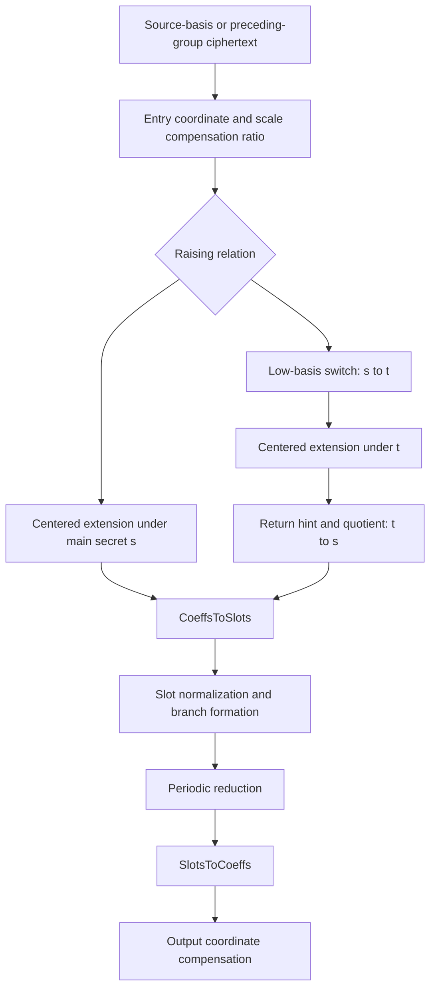

# Composable CKKS bootstrapping

FHElium composes bootstrapping from replaceable mathematical components executed through the ordinary `fhelium.eager.Engine`, `Ciphertext`, NTT, and native operator stack. The built-in `FullSlotBootstrap` makes its linear maps, periodic reduction, depth budget, primitive-key requirements, and arithmetic scale schedule visible.

## The mathematical map

Let:

- $N$ be the ring dimension and $S=N/2$ the complex slot count;
- $\Delta_0$ be `bootstrap.input_scale`, which defaults to `config.default_scale`;
- $q_b$ be the product of the source Q suffix selected by `source_depth`;
- $C$ and $T$ be the unscaled CoeffsToSlots and SlotsToCoeffs maps, with $T(C(a))=Sa$ in FHElium's cyclotomic slot order;
- $B$ be a periodic reducer's `input_bound`.

Entry accepts the source Q basis directly or rescales its preceding group into that basis. The default source is the terminal Q group. Centered ModRaise extends the components into the Q basis at `modulus_raise_target_depth`; encapsulated raising first changes the secret relation, extends the centered components and returns to the original relation. After the compensated entry-coordinate conversion described below, let $a$ be the coefficient-coordinate value represented by the raised ciphertext at scale $\Delta_0$. Define

$$
w=\frac{\Delta_0}{Sq_b}C(a),\qquad
r_{\rm R}=2\operatorname{Re}(w),\qquad
r_{\rm I}=2\operatorname{Im}(w).
$$

The values $r_{\rm R}$ and $r_{\rm I}$ are **raw branch coordinates**. The polynomial coordinate is the distinct normalized value

$$
x=r/B\in[-1,1].
$$

The built-in periodic reduction approximates

$$
\rho(r)=\frac{\sin(\pi r)}{\pi}.
$$

For $r=2k+\epsilon$, where $k$ is an integer carry and $\epsilon$ is small, $\rho(r)$ approximates $\epsilon$. Branch recombination and SlotsToCoeffs then apply the idealized map

$$
a_{\rm out}=\frac{q_b}{2\Delta_0}
T\left(\rho(r_{\rm R})+i\rho(r_{\rm I})\right).
$$

The polynomial fit, CKKS rounding, and key switching perturb this idealized expression. `input_bound` states the mathematical precondition that applications must establish: $|r_{\rm R}|,|r_{\rm I}|\le B$ and validate the resulting error distribution.

## Modulus raising and secret relations

### Centered raising

A coefficient/standard Q ciphertext defines a residue class for each component coefficient. Centered raising selects its signed representative modulo the source product $q_b$ and reduces that integer into each target Q prime. The represented coefficient integer and recorded scale are preserved by the extension. Decryption under the same secret has the original low-basis phase plus $q_bI$ for an integer polynomial $I$. Periodic reduction removes the corresponding integer-period contribution after the Fourier map.

### Sparse-secret encapsulation

An encapsulated construction first switches from main secret $s$ to an intermediate secret $t$ on the source basis. Its low digit keys satisfy

$$
b_j+a_jt=P_{low}E_js+e_j.
$$

The centered components are then extended into a larger basis. A return hint encrypted under $s$ satisfies

$$
H_0+H_1s=(q_\star P_{return})t+e.
$$

The lifted second component multiplies this hint, and a common quotient by $q_\star P_{return}$ restores the main-secret relation. The lifted first component supplies the ordinary contribution. Fourier transforms, polynomial evaluation and the refreshed output all use $s$.

A fixed-weight intermediate secret has a selected number of nonzero coefficients and independent signs. Its coefficient convolution changes the distribution and extent of the integer phase $I$. That phase range, the source modulus relative to the coordinate scale, and the periodic approximation jointly determine the refresh's numerical behavior. The raising component holds the public low and return hints; the secret is a key-generation input rather than an execution input.

The low and return bases, secret distributions and jointly published key relations are construction parameters. A bit-security claim requires their associated assumptions and attack assessment; the main QP size alone does not describe this joint transcript.

## Full-slot state flow

The built-in callable executes:

All public pipeline ciphertexts have axes `[component, *batch, limb, coefficient]`, two components, Q basis, and `prime_ids`. They remain in coefficient domain with standard residues between operations. NTT-domain Montgomery values may span a complete polynomial or double-angle chain before returning to the coefficient-domain pipeline. Each linear stage removes one Q group, whose product is $M_d$ at depth $d$. `BootstrapArithmetic` uses supplied depth targets or derives its default schedule backward from the terminal target $s_D=\Delta_0$:

$$
s_d=\sqrt{M_d s_{d+1}}.
$$

Ciphertext multiplication at $s_d$ followed by group rescale therefore has scale $s_{d+1}$. A scalar or diagonal product with input scale $\Delta$ uses plaintext scale $M_d s_{d+1}/\Delta$ to reach the same target. Every rescale retains its actual quotient scale; it is not reset to the default.

For preceding-group entry, preparation multiplies residues and scale by integer $k=\max(1,\lceil M_{input}\Delta_0/\Delta_{in}\rceil)$, preserving the message. After entry rescale the actual source-basis scale is $\Delta_b$. Direct source-basis entry uses the existing scale as $\Delta_b$. The fixed circuit interprets that payload at scale $\Delta_0$, so its message coordinate is $u=(\Delta_b/\Delta_0)m$. It refreshes $u$ using fixed CoeffsToSlots and SlotsToCoeffs maps. Multiplying the output scale by $\Delta_b/\Delta_0$ restores coordinate $m$. The compensation is part of the full-slot mathematics; intermediate rescale outputs still retain actual scale.

Independent polynomial components derive basis scales from their input's actual scale rather than assuming it matches a full-slot stage. Coefficient products and accumulators connect the resulting basis values to the requested output scale. Available precision and integer-encoding range still limit which input scales, degrees, and modulus groups can be evaluated accurately.

Key-switch basis extension defaults to the exact Garner lift. For a digit product $D$, any lift with the same source residues differs by an integer multiple of $D$. The normalized linear CRT lift uses a representative in $[0,wD)$ for $w$ source rows; the raw linear CRT lift can be larger. Those representatives multiply the evaluation-key error, so choosing `normalized_crt` or `crt` requires a noise budget consistent with the digit partition, auxiliary product P, actual scales and complete refresh precision.

## Raw and normalized reducer coordinates

`CosineDoubleAngleReduction` distinguishes raw and normalized input coordinates:

- `reference(values)` always consumes normalized $x\in[-1,1]$ and never divides by `input_bound`;
- `evaluate(...)` consumes raw $r$ when `fuse_input_normalization=False` and spends one depth computing $x=r/B$;
- with `fuse_input_normalization=True`, the caller must already provide $x$. `FullSlotBootstrap` does so by folding $1/B$ into CoeffsToSlots.

Both routes target $\sin(\pi Bx)/\pi=\sin(\pi r)/\pi$. Confusing the two coordinates changes the periodic frequency by a factor of $B$.

## Replaceable decisions

A polynomial evaluator chooses a homomorphic multiplication directed acyclic graph (DAG) for the stored approximation.

| Component | Replaceable decision |
|---|---|
| polynomial approximator | How a function becomes basis-tagged coefficients |
| polynomial evaluator | Which homomorphic multiplication DAG evaluates them |
| linear-transform compiler | How a basis map becomes executable stages |
| linear-transform evaluator | Direct, BSGS, or another stage schedule |
| periodic reduction (`modular_reduction`) | Cosine recurrence or a caller-supplied periodic approximation |
| ordinary Python | Complete algorithm topology and control flow |

A `PolynomialApproximation` stores coefficients in ascending degree. Power basis means $p(x)=\sum_n a_nx^n$; Chebyshev basis means $p(x)=\sum_n a_nT_n(x)$. If an approximator records a physical domain $[a,b]\ne[-1,1]$, its coefficients are still functions of the normalized coordinate $x=(2t-a-b)/(b-a)$. An evaluator never performs that affine map implicitly.

## Direct and BSGS linear evaluation

A cyclic-diagonal stage represents

$$
L(x)=\sum_k d_k\mathbin{\odot}\operatorname{Rot}_k(x).
$$

The direct evaluator computes every term independently. The baby-step/giant-step (BSGS) evaluator writes $k=g+b$ and uses

$$
\operatorname{Rot}_g\left(
  \operatorname{Rot}_b(x)\mathbin{\odot}
  \operatorname{Rot}_{-g}(d_{g+b})
\right)
=
\operatorname{Rot}_{g+b}(x)\mathbin{\odot}d_{g+b}.
$$

They therefore implement the same mathematical map, output depth, actual-scale recurrence, domain, basis, and `prime_ids`. Their operation grouping and CKKS rounding can differ, so residue tensors need not be bit-identical.

Within one BSGS giant group, the built-in evaluator dispatches the represented sum

$$
\sum_t c_t p_t
$$

as one RNS operation. Its CPU implementation reuses the ordinary Montgomery product and standard-add primitives. Its CUDA implementation keeps one modular accumulator per output coefficient and reads existing ciphertext/plaintext Tensors through a bounded pointer set; it does not stack all term products or encode BSGS policy into the native operation.

BSGS creates two reusable sets: the distinct baby rotations and the partial sums for giant groups. Group-major traversal retains the baby rotations and completes a bounded block of groups at a time; each rotation's final block consumer ends its lifetime. Baby-major traversal retains group partial sums and consumes one baby rotation at a time. The default traversal retains the smaller set by cardinality, choosing group-major on a tie. A caller may choose either traversal for a stage.

Within one linear stage, both sets contain two-component ciphertexts with the same batch, Q-row and ring extents. If $R$ is the number of distinct babies, $G$ the number of giant groups, $b$ the batch extent, $L_Q$ the Q-row count and $w$ the residue word size, their represented storage sizes are

$$
M_{baby}=2RbL_QNw,\qquad M_{groups}=2GbL_QNw.
$$

The current block of group sums, hybrid-digit preparation, key-product scratch and diagonal materials are additional live storage. With direct baby keys, one prepared QP digit set can serve successive rotations without requiring all rotation outputs to coexist. Composed inventories perform their keyed rotation paths. Both traversals preserve each group's term order and process giant offsets in increasing order. The quotient schedule is selected independently of traversal.

Binary-decomposition Chebyshev evaluation shares a basis node until its final recurrence or coefficient consumer. Coefficient products at a common depth can be accumulated before all other basis nodes have been produced; their group rescale remains a depth transition of the summed product. This separates the arithmetic dependencies from retaining every intermediate through the end of the polynomial. Block-factorized evaluation instead builds its shared binary basis, then retains the aligned baby values and pending giants while consuming coefficient blocks.

The aggregate giant-step schedule sums unrounded key products in QP, including the ordinary ciphertext components multiplied by P, before dividing once by $PM_d$. Here P is the product of auxiliary primes and $M_d$ is the product of the complete dropped Q group. The independent schedule rescales and key-switches each giant before its Q result joins the sum. Rounding a sum and summing rounded values generally differ, so the two schedules have the same ideal linear map and actual scale transition but different noise realizations and storage costs.

The available output depth is determined jointly by the modulus chain and the component depth costs. If the input depth is $d_{in}$, output depth is $d_{out}$ and terminal depth is $D$, the remaining depth is $D-d_{out}$ and the repeatable refresh window is $d_{in}-d_{out}$. Additional residual Q groups and different Fourier or polynomial schedules change this window together with the scale and error budget.

## Shared key inventory and consumer requirements

`EvaluationKeySet` is an application-owned collection of ordinary rotation, relinearization and conjugation key values. A bootstrap consumes it through `evaluation_keys=`. The inventory can retain several physical layouts and device copies for one operation, allowing different compositions and stages to share available material. Its membership is independent of consumer depth: active Q rows, digit supports, P rows, ring dimension, dtype and device determine suitability. [Key lifecycle](key-lifecycle.md) defines inventory ownership and key relations.

`required_rotations` and `key_steps()` describe the transform rotation schedule. Relinearization is required when the reduction performs ciphertext products, and conjugation is required by branch handling and reconstruction. Provisioning generates missing capabilities before material discovery; `create_evaluation_keys` reuses compatible inventory groups and accounts for their additional storage across the composition. One key shared by several stages can cost less than separate compact keys for each stage.

Hoisted baby rotations share prepared source digits. The selected keys must form a compatible group with the same effective digit supports and physical interpretation. A collection of individually usable step keys can fail that shared-preparation requirement. Direct keys and composed rotation paths also differ in online operations, scratch storage and key-switch error.

Rotation, relinearization and conjugation keys use the main secret relation. An encapsulated raising component additionally retains low and return switch keys, whose intermediate secret and auxiliary moduli are independent construction parameters. The application maintains these relations and the parameter context; structural key selection does not prove them.

## Profile choices

A profile selects transform stage counts, polynomial degree, periodic-reduction bound and branch schedule. `key_steps("signed_power_of_two")` describes the compact composed-rotation inventory; `key_steps("all_required")` describes direct transform rotations. `key_steps("signed_power_of_two_with_baby_steps")` augments signed-power coverage with direct baby steps from the selected BSGS partitions. A caller may also supply a mixed inventory, which the evaluator resolves per requested rotation.

The Engine supplies the Q chain and arithmetic contexts. Source and entry depths, input scale and per-depth coefficient-product targets complete the scale schedule. Accuracy, resident storage and latency depend on this composition, the key inventory and the represented input class.

The profiles specify component parameters and depth costs. The output-depth column assumes `modulus_raise_target_depth=0`; construction still rejects an Engine whose `max_depth` is too small for the selected composition.

| Profile | Raw bound $B$ | Polynomial degree | Double-angle iterations | CTS stages | STC stages | Output depth |
|---|---:|---:|---:|---:|---:|---:|
| `7/44` | 1024 | 44 | 7 | 2 | 2 | 19 |
| `8/28` | 1024 | 28 | 8 | 2 | 2 | 19 |
| `8/28-s2c3` | 1024 | 28 | 8 | 2 | 3 | 20 |
| `3/30` | 32 | 30 | 3 | 4 | 3 | 17 |

The bound column describes the raw reduction coordinate. The degree-30 profile uses the even-polynomial identity $p(x)=q(T_2(x))$, a shifted seed coordinate and normalization in the final forward-transform stage. Its raising relation must establish the narrower coordinate range. The shared RNS implementation centers and extends arbitrary supported source-basis widths.

## Evaluation schedules and numerical materials

A polynomial approximation specifies coefficients and a basis coordinate. Its evaluation schedule specifies dependencies, depth transitions and the placement of relinearization and rescale. Binary decomposition shares individual Chebyshev nodes; block factorization forms coefficient-weighted baby polynomials and multiplies them by shared giant nodes. The represented polynomial is unchanged, while rounding and key-switch noise depend on the chosen schedule. Complex polynomial evaluation retains the imaginary component.

Constant slot messages admit compact period-one encoding. Cached scalar plaintexts retain an encoded stochastic-rounding sample at a particular actual scale, prime-row set, representation and device. Reusing that material does not consume further rounding randomness. Rotation-key inventories similarly reflect an execution choice: signed-power keys permit compositions, while direct baby keys permit shared decomposition within suitable BSGS groups. The key inventory and its resident storage are distinct from the mathematical rotation offsets.

## Normalized core and prepared execution

For preceding-group entry, preparation multiplies residues and scale by an integer $k$, then rescales through the entry Q group of product $M$. The source-basis actual scale is $\Delta_b=k\Delta_{\mathrm{in}}/M$. Direct source-basis entry uses $\Delta_b=\Delta_{\mathrm{in}}$. Interpreting that payload at the configured scale $\Delta_0$ gives the normalized message coordinate $u=\tau m$, where $\tau=\Delta_b/\Delta_0$. The core refreshes $u$; multiplying the output's recorded scale by $\tau$ restores the message coordinate $m$. The output envelope carries this compensation separately from the core's payload and metadata.

A prepared core binds component objects, an input state and device, and the selected key references and encoded materials. During material discovery, the executing consumer selects keys from the shared inventory and records the actual choices in ordinary dictionaries. Preparation consumes the normal first-encoding rounding samples; subsequent execution uses those samples and bound keys. The prototype ciphertext and preparation output are temporary.

Each prepared core owns its material dictionaries. Appending to or clearing the inventory leaves existing prepared bindings unchanged because those dictionaries retain their selected references. The key Tensor contents remain live. `PreparedBootstrap` combines this core with entry and finish, supplying one computation body to ordinary Eager execution and Compile capture. Backend execution consumes the represented key and table Tensor operands.

Encoded NTT diagonals can use contiguous repeated-block storage. If a row changes value at position $i$, a repeated block of length $R$ must place $i$ on a block boundary. For power-of-two ring extent $N$, the largest shared valid block across all rows is $R=\min(\{N\}\cup\{\operatorname{lowbit}(i):i\text{ is a change position}\})$. The stored extent is $U=N/R$. This criterion preserves every encoded integer and finds the minimum extent within this layout. A value with $U=N$ retains dense storage.

## Real-valued slot composition

`FullSlotBootstrap(message_domain="real")` refreshes ciphertexts whose decoded CKKS slots are real-valued. The default `"complex"` composition retains both periodic-reduction branches. A real-valued source model does not establish the real-slot precondition when its packing uses imaginary slot coordinates. The precondition belongs to the caller; encrypted data is not inspected to select a composition.

For the radix-2 SlotsToCoeffs map $T$, let $H=\operatorname{diag}(1/2,1,\ldots,1)$. Real-slot reconstruction evaluates only the real coefficient branch and forms $z+\overline z$ after applying $T H$. The factor $H$ corrects the constant polynomial coefficient, which would otherwise be counted twice by conjugate addition. For a cyclic-diagonal stage $L(x)=\sum_k d_k\odot\operatorname{Rot}_k(x)$, composing $L H$ replaces its diagonal by $d_k\odot\operatorname{Rot}_k(H)$. The first STC stage owns this adjustment; depth and actual scale are preserved by the final conjugation and addition. The built-in real composition requires the generator-5 radix-2 STC compiler.

The corrected transform is a new plan with its own encoded material entries. Its diagonal repetition can differ from the complex plan, so real-slot execution may retain more plaintext storage even though it evaluates one reduction branch. Both compositions use the same entry, preparation, core execution, finish and release lifecycle.

## Represented weighted sums

A weighted-sum row computes $y=\sum_t c_t p_t R^{-1}\bmod q$ independently in each active prime row. Ciphertexts retain their full polynomial extent; each plaintext may use dense, cyclic, contiguous or strided-sparse storage. Sparse implicit residues are ordinary Tensor operands. Representation affects indexing, not the mathematical sum or its output depth and scale.

The native implementation uses grouped execution for dense rows and primitive products for mixed representations. The CUDA Triton implementation fuses each row's products and additions using the existing RNS expression generator. A term chunk limits each generated expression; partial sums are combined modulo the same primes. Chunking does not cross a key switch or rescale and does not change CKKS rounding.
