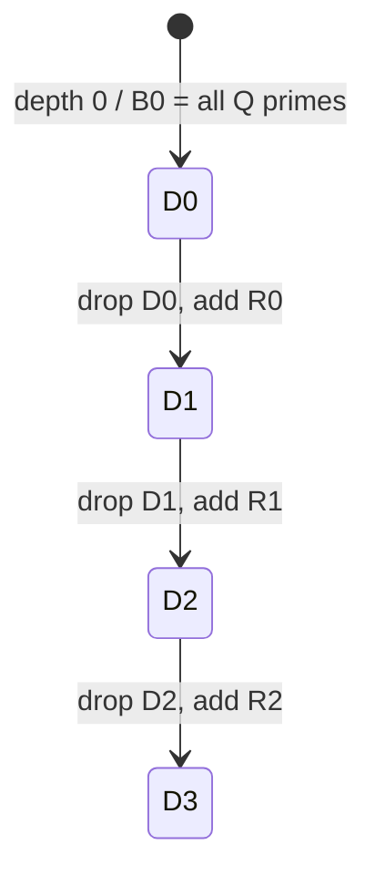

# Configuration and modulus chain

`CkksConfig` fixes the mathematical CKKS parameter set of an execution context: the polynomial ring, the ordered Q prime list, the active Q basis and default scale of every depth, the special primes used for key switching, the Galois generator, the error distribution, and the security-budget selection. The Q and P moduli are stored as prime values. This page defines the ring, the modulus chain, the RNS representation of coefficients, the relation between depth, scale, and prime widths, and the residue format the Engine derives from the primes.

## Ownership

| Object | Responsibility |
| --- | --- |
| `Preset` | Select a named parameter baseline and resolve it to prime values |
| `CkksConfig` | Store the placement-independent CKKS and security parameters |
| `fhelium.eager.Engine` | Select an RNS execution format and lazily create device-local arithmetic, random, and key resources |

A benchmark profile and a Bootstrap circuit are separate objects. Neither redefines CKKS parameters.

## Ring and slots

For `logN = k`,

$$
N=2^k, \qquad S=N/2.
$$

$N$ is the degree of the polynomial ring $\mathbb Z[X]/(X^N+1)$, and $S$ is the number of complex CKKS slots. Increasing $N$ increases slot capacity and the available security and noise budget, and also increases every polynomial, key, transform, and residue tensor.

## Q bases and P special primes

FHElium stores the ciphertext modulus primes as one ordered list $q_0,\ldots,q_{L-1}$ in `config.q_moduli`. Each depth $d$ selects a set of those primes as its **active Q basis**:

$$
B_d\subseteq\{q_0,\ldots,q_{L-1}\},
\qquad
Q_d=\prod_{q\in B_d}q.
$$

`config.q_bases[d]` lists the prime IDs of $B_d$ in increasing order, `config.q_prime_ids(d)` returns them, and `config.active_q_moduli(d)` returns the prime values. Tensor row $j$ of a depth-$d$ Q value is reduced modulo `q_moduli[q_bases[d][j]]`. `config.max_depth` is $D=$ `len(q_bases) - 1`. The depth-0 basis $B_0$ contains every Q prime. Consecutive bases need not be nested: the transition from depth $d$ to $d+1$ drops the primes

$$
D_d=B_d\setminus B_{d+1}
$$

and introduces the primes

$$
R_d=B_{d+1}\setminus B_d ,
$$

and a prime may leave a basis and return at a later depth. Every transition drops at least one prime. `config.basis_transition(d, d + 1)` returns the dropped and introduced prime IDs. The **rescale ratio** is

$$
\rho_d=\frac{\prod_{q\in D_d}q}{\prod_{q\in R_d}q},
$$

which `config.rescale_divisor(d)` and `config.transition_ratio(d, d + 1)` return as a `fractions.Fraction`. A chain with $R_d=\varnothing$ for every $d$ is a **suffix chain**: each basis is a suffix of the previous one, and $\rho_d$ is the product of the dropped primes. `CkksConfig.suffix_chain(q_depth_groups=..., scale=..., p_moduli=..., logN=...)` builds a suffix chain from ordered prime groups, `CkksConfig.catalog_suffix_chain(...)` builds a one-prime-per-depth suffix chain from the packaged prime catalog, and `config.is_suffix_chain` reports the property.

The special primes $p_j$ are stored in `config.p_moduli`, with product

$$
P=\prod_j p_j .
$$

Hybrid key switching temporarily extends a Q value to a QP basis and removes P by ModDown. `config.key_layout(d)` returns the default key layout for consumers at basis $B_d$: its auxiliary primes are the largest configured primes outside $B_d$, which may include Q primes inactive at depth $d$, and its decomposition digits are consecutive runs of $B_d$. P is not part of the depth sequence.

For a dense RNS tensor, the limb axis is ordered as

```text
[active Q rows in Q order, auxiliary P rows]
```

when `modulus_basis="QP"`, and contains only the first region when `modulus_basis="Q"`. `prime_ids` records which configured prime each local row represents.

## Rescale ratios of the built-in presets

A parameter planner chooses $\rho_d$ near the scale introduced by one multiplication. The built-in presets combine primes near $2^{30}$ and $2^{25}$ in their application chain, for example in `slots16384-scale40-depth16`:

```text
depth 1 -> 2: D_1 = [q_21, q_22, q_23] (near 2^30), R_1 = [q_0, q_1] (near 2^25), log2 rho_1 = 40.07
depth 2 -> 3: D_2 = [q_0 ... q_3] (near 2^25),     R_2 = [q_21, q_22] (near 2^30), log2 rho_2 = 39.87
```

Each such transition consumes one depth and reduces the active modulus by approximately 40 bits, without requiring one 40-bit prime per depth. The execution cost of a depth follows the row count $|B_d|$, which these chains keep close to the minimum needed for the remaining modulus. Introducing primes in $R_d$ lets the ratio follow the scale; a suffix chain is the special case in which each depth drops a fixed group.

A preset with a `-boot{k}` suffix additionally contains the depths consumed by its bootstrap profile, whose rescale ratios follow that circuit's schedule and whose primes have about 25, 28, and 30 bits; `k` application depths remain after a refresh. [Composable CKKS bootstrapping](composable-bootstrapping.md) describes that segment.

## Integers, RNS, and the Chinese remainder theorem

A **Residue Number System (RNS)** represents an integer modulo a product of pairwise-coprime moduli. At a fixed depth, write the active Q primes as $q_0,\ldots,q_{L-1}$ and their product as $Q$. The map from an integer $a$ to its residue vector is

$$
a\longmapsto(a_0,\ldots,a_{L-1}),
\qquad a_i=a\bmod q_i.
$$

Each remainder fits its individual modulus even when $Q$ is much larger than a machine integer. The **Chinese remainder theorem (CRT)** establishes the ring isomorphism

$$
\mathbb Z/Q\mathbb Z
\;\cong\;
\prod_{i=0}^{L-1}\mathbb Z/q_i\mathbb Z.
$$

The residues therefore determine one integer class modulo $Q$. Integers differing by a multiple of $Q$ have the same representation, and selecting a representative interval makes reconstruction unique within that interval.

### Reconstruction and signed representatives

Let $Q_i=Q/q_i$ and $u_i=Q_i^{-1}\bmod q_i$. The standard representative is

$$
a_{\mathrm{std}}
=\left(\sum_{i=0}^{L-1}a_i Q_i u_i\right)\bmod Q,
\qquad 0\le a_{\mathrm{std}}<Q.
$$

Each term reproduces its own residue and vanishes modulo the other primes. For odd moduli, the centered representative is

$$
a_{\mathrm{ctr}}=
\begin{cases}
a_{\mathrm{std}},&a_{\mathrm{std}}\le (Q-1)/2,\\
a_{\mathrm{std}}-Q,&a_{\mathrm{std}}>(Q-1)/2.
\end{cases}
$$

A signed integer in the centered interval is recovered with its sign; a value outside that interval wraps to another representative of its class.

With moduli $(5,7,11)$, $Q=385$. The integer $123$ maps to $(3,4,2)$. The reconstruction weights $Q_i u_i$ are $(231,330,210)$, giving

$$
(3\cdot231+4\cdot330+2\cdot210)\bmod385=123.
$$

The integer $-123$ maps to $(2,3,9)$. Its standard reconstruction is $262$, and its centered reconstruction is $262-385=-123$.

A mixed-radix form expresses the same standard representative as

$$
a_{\mathrm{std}}=\sum_{i=0}^{L-1}d_i\prod_{k=0}^{i-1}q_k,
\qquad 0\le d_i<q_i,
$$

where an empty product equals one. The digits $d_i$ are computed successively from the residues using inverses of preceding prime products modulo $q_i$; they support centered comparison and numerical reconstruction through multiply-add steps.

### Polynomial coefficients

CKKS applies this representation to every coefficient of a polynomial in $\mathbb Z_Q[X]/(X^N+1)$. If $a(X)=\sum_{j=0}^{N-1}a_jX^j$, row $i$ stores

$$
a^{(i)}(X)=\sum_{j=0}^{N-1}(a_j\bmod q_i)X^j.
$$

An RNS Tensor therefore has a prime-row axis and a polynomial-coordinate axis; a row contains one residue of every coefficient. CRT preserves addition and multiplication, so polynomial arithmetic modulo $Q$ becomes independent polynomial arithmetic modulo each $q_i$ with the same reduction by $X^N+1$. An NTT transforms each row's coefficients to evaluations for multiplication; Montgomery representation changes how each row's residues are stored for modular arithmetic. Both retain the prime basis.

Decryption uses mixed-radix reconstruction over the active Q rows to select the centered phase, then produces binary64 approximate coefficients for slot decoding. The CRT formulas define the represented integer class; binary64 conversion determines the precision of the decoded output.

### Removing and extending a basis

Dropping Q rows projects the residue class onto the product of the remaining primes and preserves the recorded scale. Rescaling from $B_d$ to $B_{d+1}$ divides every coefficient by $\rho_d$ with one rounding step for the complete dropped set; its equation is given in [Evaluator operation transitions](evaluator-operation-transitions.md#rescale-changes-depth-scale-rows-and-payload).

Extending a basis requires a representative convention. One residue vector identifies a class containing both $a$ and $a+Q$, which can have different residues modulo a new prime. The convention selects the integer representative whose residues are computed in the extended basis. Hybrid ModUp extends the selected decomposition digit, and centered ModRaise extends a centered source representative.

## Depth and depth remaining

**Depth** identifies the active Q basis $B_d$:



Depths lie in `0 <= depth <= max_depth`, and

```text
depth_remaining = max_depth - depth
```

is the number of further one-depth transitions in this chain; `config.depth_remaining(d)` and `engine.depth_remaining(value)` report it. Depth records a basis position, not the number of multiplications or rescale calls already executed. A caller may create a value at a selected depth, switch its basis, or accumulate several multiplications before one rescale when the remaining modulus and precision permit that schedule. A Bootstrap composition declares its own entry depth; [Composable CKKS bootstrapping](composable-bootstrapping.md) defines it.

## Scale is independent of prime width

`config.scales[d]` is the default scale $\Delta_d$ of depth $d$, and `config.scale_at(d)` returns it. Every plaintext and ciphertext carries its own positive finite actual scale, and a rescale from depth $d$ divides it by $\rho_d$. Built-in presets set the maximum-depth scale $\Delta_D=2^{b}$ for their scale bits $b$ and derive earlier entries by

$$
\Delta_d=\sqrt{\Delta_{d+1}\,\rho_d},
$$

so the rescaled product of two default-scale values at depth $d$ has scale $\Delta_{d+1}$. Because $\rho_d$ is a ratio of prime products, a scale near $2^{40}$ does not require an approximately 40-bit Q prime per depth.

In `slots16384-scale40-depth16`, $\log_2\Delta_1=40.002$, $\log_2\rho_1=40.069$, and $\log_2\Delta_2=39.936$. Multiplying two depth-1 values with scale $\Delta_1$ gives scale $\Delta_1^2$ at depth 1; rescaling multiplies by $q_0q_1$, divides by $q_{21}q_{22}q_{23}$ with one rounding step, represents the result over $B_2$, and records $\Delta_1^2/\rho_1=\Delta_2$. `depth_remaining` changes from 15 to 14.

Prime widths, actual scale, and residue dtype are therefore separate quantities. The prime set controls the represented modulus, the actual scale controls the interpretation of the encoded magnitude, and the residue dtype controls the word size and modular arithmetic of each row. The full scale and depth transition laws of each operation are given in [Evaluator operation transitions](evaluator-operation-transitions.md).

## RNS execution format

Encoding and residue execution use two consecutive representations:

```text
slots
  -> signed int64 integer coefficients
  -> residues modulo every active Q prime
  -> Engine-selected integral RNS Tensor
```

`integer_coefficients_to_rns` reduces each signed `int64` coefficient modulo the active primes and writes the result in `engine.dtype`. Ciphertexts and live keys retain that dtype.

When an Engine is constructed, it examines every configured Q and P prime and selects the narrowest supported residue Tensor and Montgomery radix: `torch.int32` with a 32-bit radix when every prime is below $2^{30}$, otherwise `torch.int64` with a 62-bit radix. Every built-in preset uses primes below $2^{30}$ and therefore runs with `torch.int32` residues. `rns_dtype=` requests a dtype and is checked against the lazy-reduction range of that format: $2^{30}$ for `torch.int32` and $2^{60}$ for `torch.int64`. The Engine uses one format for its lifetime. Device-local `RnsContext` resources own the dense RNS parameters, Montgomery radix, lazy-reduction bounds, and residue arithmetic in that format; `NttContext` composes that context and owns the NTT policy, transform tables, and transforms. None of these enter `CkksConfig`.

The registered CKKS and RNS operations have one schema for every format; native dtype dispatch selects the scalar specialization of the same implementation. The operation graph, Ciphertext type, depth transition, and Backend registration are the same for `int32` and `int64` execution.

## Parameter identity and serialization

A resolved configuration contains:

```text
logN
q_moduli
q_bases
scales
p_moduli
galois_generator
sigma
security_bits
enforce_security_budget
```

`CkksConfig.dumps()` serializes these values with the FHElium package version. `CkksConfig.parse()` reconstructs a configuration from such a mapping or from a `Preset`, accepts keyword overrides, and rejects unknown fields and serializations written by another FHElium version. Runtime placement, process groups, caches, NTT implementation choice, and RNS dtype do not enter configuration identity.

## Cost and security consequences

Let $L_d=|B_d|$ be the number of active Q prime rows. An unbatched two-component Q ciphertext at depth $d$ stores

$$
2\,L_d\,N\,W
$$

bytes of Tensor payload, where $W$ is the number of bytes per residue element. A homogeneous batch multiplies this by the product of its batch extents. Evaluation keys add digit, component, and QP axes and commonly dominate memory. More Q rows provide modulus capacity and increase transforms, key products, and storage.

The built-in security assessment applies to the product of all configured Q and P primes, which bounds the modulus of every key. A parameter plan must also validate numerical precision, message range, error growth, and native arithmetic bounds for its workload.

## Related concepts

- [Value-state transitions](value-state-transitions.md)
- [Value model and identity](value-model-and-identity.md)
- [Evaluator operation transitions](evaluator-operation-transitions.md)
- [Key lifecycle](key-lifecycle.md)
