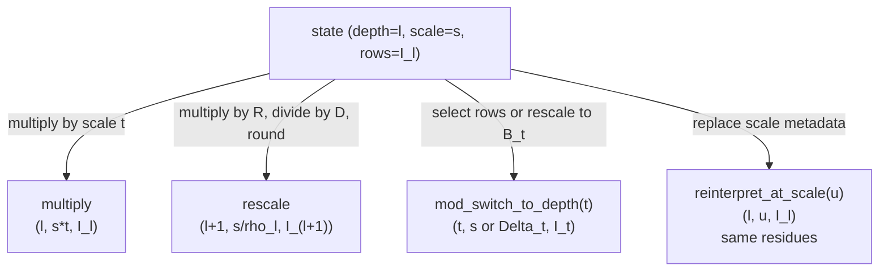
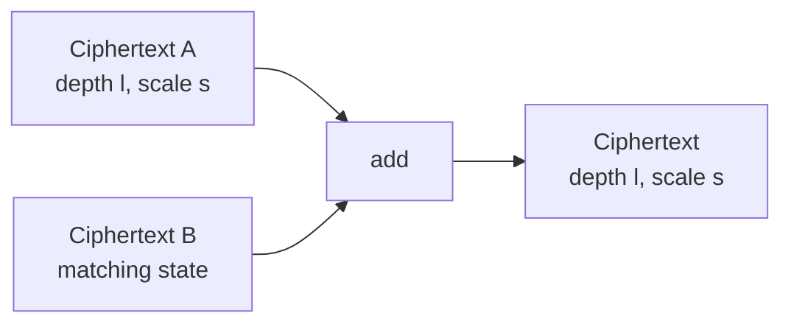
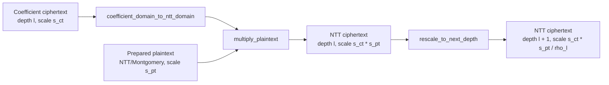
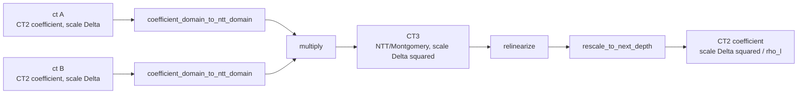
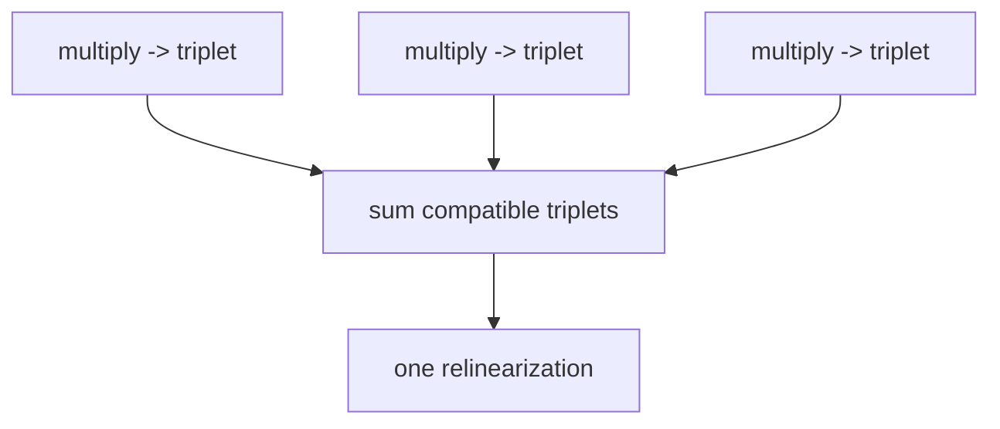
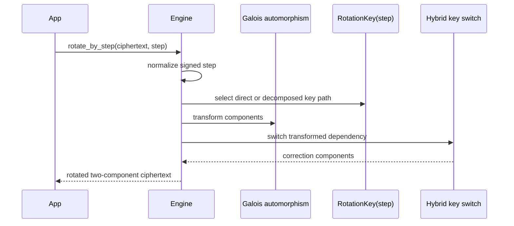

# Evaluator operation transitions

FHElium evaluator operations transform values through separately invoked arithmetic, component-count, key-dependency, and modulus-chain steps. This page defines the state effects and operand requirements of addition, scalar arithmetic, multiplication, relinearization, rescale, modulus switching, scale reinterpretation, key switching, and rotation. The state axes themselves and the primitive domain and residue conversions are defined in [Value-state transitions](value-state-transitions.md); the modulus chain and rescale ratio are defined in [Configuration and modulus chain](context-and-modulus-chain.md).

Throughout, a value $v$ at depth $\ell$ has actual scale $\Delta(v)$ and rows $I_\ell=$ `q_prime_ids(ℓ)`. For $\ell<D$, $D_\ell=B_\ell\setminus B_{\ell+1}$ are the primes leaving the basis, $R_\ell=B_{\ell+1}\setminus B_\ell$ the primes entering it, and

$$
\rho_\ell=\frac{\prod_{q\in D_\ell}q}{\prod_{q\in R_\ell}q}
$$

is the rescale ratio.



## Addition requires matching state



Ciphertext addition and subtraction preserve depth and scale. Their operands satisfy

$$
\ell_a=\ell_b,
\qquad
\Delta(a)=\Delta(b)
$$

with binary64 equality, together with equal shape, component count, polynomial domain, modulus basis, residue representation, and prime IDs. A scale difference of one unit in the last place violates this requirement. The caller supplies compatible operands to `add`, `subtract`, and `sum_ciphertexts`; Tensor dispatch does not align scales, depths, or keys. Binary64 expression order is observable, so branches that will be added use a common scale calculation history.

`add_plaintext` adds a prepared plaintext to ciphertext component zero and preserves the later components. The operands match in depth, actual scale, prime rows, modulus basis, and polynomial domain. The plaintext uses Montgomery residues; the ciphertext uses standard residues in coefficient domain or Montgomery residues in NTT domain. An unbatched prepared plaintext may broadcast over a ciphertext batch; a batched plaintext has the ciphertext batch shape.

`add(a, b)` returns a new value; `add_(a, b)` updates the left operand's storage.

A program aligns the two axes separately:

1. choose encoding scales and multiplication histories that produce equal actual scales;
2. use `mod_switch_to_depth` when only the active Q depth must advance;
3. apply `reinterpret_at_scale` with a bound when the resulting message-ratio change is part of the numerical policy.

## Scalar arithmetic

`add_scalar(ciphertext, u, scalar_scale=δ)` samples $k=\operatorname{RandRound}(u\delta)$ and adds $k\bmod q_i$ to the constant coefficient of component zero in every active row. Its input is coefficient-domain with standard residues. The ciphertext actual scale $\Delta_c$ is preserved, so the represented change is approximately $u\delta/\Delta_c$; the default $\delta=\Delta_c$ gives slot-wise addition of $u$.

`multiply_constant(ciphertext, u, output_scale=Δ', rescale=...)` multiplies the represented message by a constant:

- with the default `rescale=True`, it multiplies by the compact plaintext of the constant slot vector $u$ at plaintext scale $\Delta_p=\Delta'\rho_\ell/\Delta_c$ and rescales once, so the result has depth $\ell+1$ and actual scale $\Delta'$, which defaults to $\Delta_{\ell+1}$; complex $u$ is supported;
- with `rescale=False`, it multiplies every component modulo each active prime by $k=\operatorname{RandRound}(u\delta)$ with $\delta=\Delta'/\Delta_c$, where $\Delta'$ defaults to $\Delta_c^2$; depth is preserved and the actual scale becomes $\Delta_c\delta$; $u$ is real.

`multiply_integer_scalar(ciphertext, k)` performs modular integer multiplication without an encoding scale and preserves both $\Delta_c$ and depth.

## Multiplication preserves depth and multiplies scale

For compatible operands,

$$
\Delta(ab)=\Delta(a)\Delta(b),
\qquad
\ell(ab)=\ell(a)=\ell(b).
$$

`multiply` and `multiply_plaintext` both consume and produce NTT/Montgomery ciphertext state over the Q basis; neither inserts a round trip through `(coefficient, standard)`. Rescale is a separate operation.

### Plaintext multiplication



`multiply_plaintext` accepts a plaintext prepared with `engine.prepare_plaintext_for_multiplication(engine.encode(...))` and a two- or three-component NTT/Montgomery ciphertext. The result stays at the input depth and component count and records the product of the operand scales. Compatible terms can be accumulated and rescaled once without an intermediate inverse transform:

```python
source_ntt = engine.coefficient_domain_to_ntt_domain(source)
term_ntt = engine.multiply_plaintext(source_ntt, prepared_weight)
sum_ntt = engine.add(sum_ntt, term_ntt)
result = engine.rescale_to_next_depth(sum_ntt)
```

`sum_plaintext_products(ciphertexts, plaintexts)` computes $\sum_t c_tp_t$ as one operation under the same requirements: every ciphertext shares its NTT/Montgomery state, depth, rows, shape, and actual scale; every plaintext shares a common actual scale; the result has scale $\Delta_c\Delta_p$. For repeated model weights, encode and prepare plaintexts once at the depths used by the evaluator.

### Ciphertext multiplication

For two two-component ciphertexts,

$$
(c_0+c_1s)(d_0+d_1s)
  =c_0d_0+(c_0d_1+c_1d_0)s+c_1d_1s^2.
$$

The $s^2$ term gives the three-component output.



`multiply` requires two components on each input, matching state, NTT domain, Montgomery residues, and the Q basis. It returns a three-component NTT ciphertext at the product scale. Ciphertext-plaintext and ciphertext-ciphertext multiplication share the multiplication domain and differ in component convolution and subsequent key requirements.

## Relinearization is a specialized key switch

Relinearization transforms the $s^2$ dependency into two components under the original secret key. It key-switches the third component with a relinearization key, adds the two correction components to the first two components, and returns a two-component ciphertext in coefficient/standard state by default, or NTT/Montgomery state with `output_domain="ntt"`. Depth and scale are preserved; `rescale=True` additionally divides by the next depth's ratio in the same quotient.

Because relinearization is a separate step, compatible triplet products may be added first and relinearized once:



This **late relinearization** trades larger three-component live storage for fewer key switches. It applies while all accumulated triplets have compatible state and no intervening operation requires two components.

## Rescale changes depth, scale, rows, and payload

`rescale_to_next_depth` accepts a complete Q or QP ciphertext with two or three components in either arithmetic state and preserves that state. For every coefficient it computes

$$
c'=\left\lfloor\frac{c\prod R_\ell+H}{\prod D_\ell}\right\rfloor
\pmod{B_{\ell+1}},
\qquad
H=\begin{cases}\lfloor\prod D_\ell/2\rfloor,&\texttt{rounding="nearest"},\\0,&\texttt{rounding="floor"},\end{cases}
$$

and records

$$
\ell'=\ell+1,
\qquad
\Delta'=\frac{\Delta}{\rho_\ell},
\qquad
I'=I_{\ell+1}.
$$

The dropped set is divided in one rounding step, regardless of how many primes it contains. The retained rows receive an arithmetic correction derived from the dropped residues, and the rows of $R_\ell$ are obtained by basis conversion of the same correction. For QP input, the Q rows change in the same way and every P row is retained. The NTT path processes the dropped rows for quotient rounding and transforms the correction without inverting the surviving rows.

With default scales, the rescaled product of two values at depth $\ell$ has scale $\Delta_\ell^2/\rho_\ell=\Delta_{\ell+1}$ for the built-in presets. Any positive finite pre-rescale scale follows the same quotient law. The Engine reports the ratio as a `fractions.Fraction` and the binary64 quotient recorded by `rescale_to_next_depth`:

```python
ratio = engine.rescale_divisor(depth=ciphertext.depth)
predicted_scale = engine.rescale_output_scale(
    pre_rescale_scale,
    depth=ciphertext.depth,
)
```

`predicted_scale` equals `pre_rescale_scale / float(ratio)` after the finite-positive check.

## Modulus switching advances depth

`mod_switch_to_depth(value, t)` moves a ciphertext from depth $\ell$ to the basis $B_t$ of depth $t$. When $B_t\subseteq B_\ell$, it selects the rows of $B_t$, and the P rows of a QP value:

$$
c'=c\pmod{B_t},
\qquad
\ell'=t,
\qquad
\Delta'=\Delta.
$$

The coefficient representatives are preserved; the message is preserved while its centered value remains within the smaller modulus.

When $B_t\not\subseteq B_\ell$, the target basis contains primes the source does not represent. With $\rho=\prod(B_\ell\setminus B_t)/\prod(B_t\setminus B_\ell)$, the operation multiplies by the integer $k=\operatorname{round}(\Delta_t\rho/\Delta)$ and performs one rescale from $B_\ell$ to $B_t$:

$$
c'=\left\lfloor\frac{k\,c\prod(B_t\setminus B_\ell)+H}{\prod(B_\ell\setminus B_t)}\right\rfloor
\pmod{B_t},
\qquad
\ell'=t,
\qquad
\Delta'=\Delta_t.
$$

The recorded scale $\Delta_t$ differs from the arithmetic scale $k\Delta/\rho$ by a relative amount of at most $1/(2k)$. `mod_switch_to_next_depth` is `mod_switch_to_depth` with $t=\ell+1$.

## Scale reinterpretation changes metadata

`reinterpret_at_scale(ciphertext, target_scale, max_relative_change=...)` leaves every residue, the depth, and the arithmetic state unchanged and records the target scale:

$$
c'=c,
\qquad
\ell'=\ell,
\qquad
\Delta'=\Delta_{\mathrm{target}}.
$$

Decoding divides by the recorded scale, so the interpreted message becomes

$$
m'=m\frac{\Delta_{\mathrm{old}}}{\Delta_{\mathrm{target}}}.
$$

`max_relative_change` bounds the symmetric ratio between the current and target scales.

## Rotation is automorphism plus key switching



`rotate_with_key` consumes a CT2 Q ciphertext in either arithmetic state. `rotate_many_with_keys` applies several rotation keys to one input; with hoisting, the outputs share key-switch preparation and each output equals the corresponding independent rotation. `sum_rotations` adds rotated values with one rounded quotient of their key products. The default output state of these operations, and of `switch_key` and `conjugate`, is `(coefficient, standard)`; `output_domain="ntt"` returns the equivalent `(ntt, montgomery)` result. `rotate_by_step` and `rotate_many_by_steps` return `(coefficient, standard)`. Every rotation preserves depth, active Q rows, component count, and actual scale; each output still needs its own automorphism, key products, and ModDown.

## State requirements by operation

| Operation | Depth | Scale | Arithmetic state |
| --- | --- | --- | --- |
| `plaintext`, `encode`, `encrypt_message` | Set the requested depth | Set the requested scale; an omitted argument selects `config.scale_at(depth)` | Produce the documented initial representation |
| `encrypt`, `decrypt` | Preserve | Preserve | Coefficient/standard ciphertext |
| `add`, `subtract`, `sum_ciphertexts` | Require equality; preserve | Require binary64 equality; preserve | Require matching state; preserve |
| `add_plaintext` | Require equality; preserve | Require binary64 equality; preserve | Matching polynomial domain |
| `negate` | Preserve | Preserve | Preserve |
| `add_scalar` | Preserve | Preserve | Coefficient/standard |
| `multiply_constant` | Advance by one; preserve with `rescale=False` | Set `output_scale`, default $\Delta_{\ell+1}$; with `rescale=False`, multiply by $\delta$ | Preserve |
| `multiply_integer_scalar` | Preserve | Preserve | Preserve |
| `multiply`, `multiply_plaintext`, `sum_plaintext_products` | Require equality; preserve | Record the product of operand scales | NTT/Montgomery in and out |
| `relinearize` | Preserve; advance by one with `rescale=True` | Preserve; divide by the ratio with `rescale=True` | CT3 NTT/Montgomery in; `output_domain` selects the output |
| `rescale_to_next_depth` | Advance by one | Divide by $\rho_\ell$ | Preserve |
| `mod_switch_to_next_depth`, `mod_switch_to_depth` | Set the target depth | Preserve when $B_t\subseteq B_\ell$; otherwise set $\Delta_t$ | Preserve |
| `reinterpret_at_scale` | Preserve | Replace with the requested scale | Preserve |
| `rotate_with_key`, `rotate_many_with_keys`, `switch_key`, `conjugate` | Preserve | Preserve | Either state in; `output_domain` selects the output |
| `rotate_by_step`, `rotate_many_by_steps` | Preserve | Preserve | Coefficient/standard out |

## Transition placement in Compile

Compile placement passes inspect multiplication results, their SSA uses, value state, and existing transition operations. A caller selects one placement policy for each transition:

- `InsertRelinearizationPass` and `InsertRescalePass` materialize the transition at the nearest safe SSA frontier;
- `LateRelinearizationPass` coalesces compatible three-component add/sub trees and places one relinearization at each region exit;
- `LateRescalePass` coalesces compatible nearest-rounding rescales across add/sub trees and places one rescale at each exit.

Relinearization and rescale placement are independent choices. Each pass recognizes an already placed transition of the other kind as a state-preserving edge where that ordering is valid, so immediate and late policies compose in either order. A caller-inserted matching `RelinearizeOp` or `RescaleOp` satisfies the corresponding multiplication path and is retained once.

The late policies support flat single-block SSA graphs. They cross compatible addition, subtraction, and negation. A fan-out is a placement frontier, so one shared transition is inserted before the split. Cross-dialect encrypted-value bridge casts carry the same ciphertext between semantic, logical, and CKKS types and may be traversed. A same-dialect CKKS cast with a different represented state is opaque: placement retains its input and target type and inserts a required transition after the cast. Rotation, conjugation, key switching, modulus switching, another ciphertext multiplication, and unknown operations are barriers. Moving a rescale across a rotation is a different approximate schedule that changes the active-Q key-switch work, rounding, and noise, so the passes do not select it.

A caller that chooses transition placement runs those passes before `AssignCkksDepthsPass` and `AssignCkksScalesPass`. The depth pass reads the represented rescale and modulus-switch nodes. The scale pass propagates per-value actual scales and never inserts arithmetic or reinterpretation operations, so a Program may retain an unrescaled scale or a three-component result when its consumer supports that state.

## Functional and in-place forms

| Form | Meaning |
| --- | --- |
| `engine.add(a, b)` | Returns a new value; inputs are unchanged |
| `engine.add_(a, b)` | Mutates the first argument |
| `value.to(device)` | Returns the same value state on another device |
| `value.replace_(other)` | Rebinds an object's storage and state |

Mutation changes the data visible through storage aliases. Its valid lifetime begins after preceding readers complete and ends before consumers that require the updated value. Functional operations retain the input contents and allocate their result according to the operation's storage behavior.

## Related concepts

- [Value-state transitions](value-state-transitions.md)
- [Configuration and modulus chain](context-and-modulus-chain.md)
- [Key lifecycle](key-lifecycle.md)
- [Composable CKKS bootstrapping](composable-bootstrapping.md)
