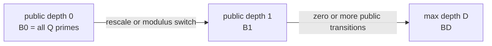
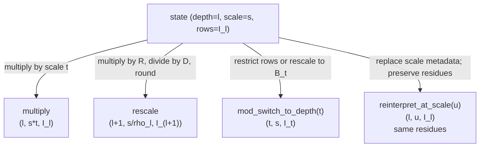

# Scale and depth lifecycle

Scale and depth are independently tracked coordinates of CKKS value state in FHElium. The application chooses encoding scales and state transitions. Evaluator operations apply their documented input contract and record the resulting scale, depth, and active modulus rows; callers must establish compatibility that a numerical implementation does not infer.

This page defines the public scale and depth coordinates, valid public depths, transition laws, compatibility requirements, and transition queries.

## Scale-depth transition state

A scale- or depth-changing operation is described by the tuple

$$
\mathcal{T}(v)=\bigl(\ell(v),\Delta(v),I(v),B(v)\bigr),
$$

where:

- $\ell(v)$ is the public Q-chain depth stored as `value.depth`;
- $\Delta(v)$ is the positive finite binary64 actual scale stored as `value.scale`;
- $I(v)$ is the ordered tuple `value.prime_ids` that maps each dense limb row to one configured parameter prime;
- $B(v)$ is the modulus basis, either the active Q basis $B_\ell$ or $B_\ell\cup P$.

`depth` and `scale` are independent coordinates. Depth selects the active Q basis, basis independently selects Q or QP, and `prime_ids` records the resulting RNS rows. Stored operation state also includes shape, polynomial domain, residue representation, component count, dtype, and device. The caller separately ensures the operands use compatible CKKS parameters.

## Default scale and actual scale

`config.scale_at(d)` is the default encoding and planning scale $\Delta_d$ of depth $d$; `config.scales` lists the values of every depth. Its scale-bit description is $\log_2\Delta_d$.

`engine.plaintext`, `engine.encode`, and `engine.encrypt_message` select $\Delta_d$ of the requested depth when their `scale` argument is `None`. Once a value exists, its `scale` field is the actual scale used by subsequent arithmetic and decoding.

The rescale ratio $\rho_d$ from depth $d$ to $d+1$ is a rational number determined by the configured primes. Built-in presets derive their default scales from the ratios, $\Delta_d=\sqrt{\Delta_{d+1}\rho_d}$, so that

$$
\frac{\Delta_d^2}{\rho_d}=\Delta_{d+1}
$$

up to binary64 rounding. FHElium records the binary64 quotient by the actual ratio; scales chosen by the caller follow the same quotient law.

All public scale entry points and value constructors require a value that can be represented as a finite Python `float` and satisfies

$$
0 < \Delta(v) < \infty.
$$

NaN, infinity, zero, negative values, booleans, and strings are rejected with `InvalidScaleError`. A scale multiplication or division that overflows or underflows the finite-positive range is rejected at the operation that produces it.

## Depth addresses active Q bases

The configuration orders the Q primes $q_0,\ldots,q_{L-1}$ and assigns each public depth $d$ a contiguous interval $B_d$ of that order, with $B_0$ containing every Q prime. `max_depth` is $D$.

A complete Q value at depth $d$ has

```python
value.prime_ids == engine.config.q_prime_ids(value.depth)
```

and a QP value at the same depth appends the special P prime IDs from `range(engine.config.num_q_primes, engine.config.total_num_primes)`. `depth` selects the active Q basis, and `prime_ids` maps each dense limb to its modulus. QP is the auxiliary basis at that depth.



Public value creation accepts depths in `[0, engine.max_depth]`. Public `rescale_to_next_depth` and `mod_switch_to_next_depth` require a following public depth, so from depth $\ell$ the number of remaining public one-depth transitions is

$$
\mathtt{engine.max\_depth}-\ell.
$$

The built-in bootstrap accepts depth `engine.max_depth - 1`. Its entry rescale reaches the ordinary terminal basis at `engine.max_depth`. Its scale schedule is documented in [Composable CKKS bootstrapping](composable-bootstrapping.md).

## Scale-depth transition laws

The following laws define multiplication, rescale, modulus switch, and scale reinterpretation.



### Multiplication preserves depth and multiplies scale

For compatible ciphertext operands,

$$
\Delta(c_{\mathrm{out}})=\Delta(c_a)\Delta(c_b),
\qquad
\ell(c_{\mathrm{out}})=\ell(c_a)=\ell(c_b).
$$

`multiply_plaintext` applies the same scale-product law to a ciphertext and an operation-ready plaintext. Both multiplication primitives require and return NTT/Montgomery ciphertext state, preserve the active Q basis, and expose domain transitions separately from scale arithmetic.

For real scalar multiplication, the caller-selected scalar scale $\Delta_s$ plays the role of the plaintext scale:

$$
\Delta(\operatorname{multiply\_scalar}(c,a,\Delta_s))
=\Delta(c)\Delta_s.
$$

The Eager default is $\Delta_s=\Delta(c)$. Rescale remains a separate operation; after a separately invoked rescale, the recorded scale is $\Delta(c)\Delta_s/\rho_\ell$. Integer scalar multiplication has no encoding scale and preserves $\Delta(c)$.

Real scalar addition quantizes its addend at a caller-selected $\Delta_s$ but preserves the ciphertext scale. It therefore changes the represented message by approximately $a\Delta_s/\Delta(c)$. Eager selects $\Delta_s=\Delta(c)$ when the argument is omitted.

### Rescale changes depth, scale, rows, and payload

At depth $\ell<D$, let $D_\ell=B_\ell\setminus B_{\ell+1}$ be the dropped primes, $R_\ell=B_{\ell+1}\setminus B_\ell$ the introduced primes, and $\rho_\ell=\prod D_\ell/\prod R_\ell$. `rescale_to_next_depth` computes, for every coefficient,

$$
c'=\left\lfloor\frac{c\prod R_\ell+H}{\prod D_\ell}\right\rfloor
\pmod{B_{\ell+1}},
\qquad
H=\begin{cases}\lfloor\prod D_\ell/2\rfloor,&\texttt{rounding="nearest"},\\0,&\texttt{rounding="floor"},\end{cases}
$$

and records

$$
\ell'=\ell+1,
\qquad
\Delta'=\frac{\Delta}{\rho_\ell},
\qquad
I'=\mathtt{q\_prime\_ids}(\ell+1).
$$

The dropped set is divided in one rounding step. For QP input, the Q rows change in the same way and every P row is retained. `rounding="nearest"` and `rounding="floor"` select different quotient laws but have the same metadata transition.

### Modulus switch advances depth

For a target public depth $t>\ell$ whose basis is contained in the source basis, $B_t\subseteq B_\ell$, `mod_switch_to_depth` restricts each residue polynomial to the target basis:

$$
c'=c\pmod{B_t},
\qquad
\ell'=t,
\qquad
\Delta'=\Delta.
$$

The operation preserves the coefficient representatives. Message preservation requires that the centered represented value remain within the smaller target modulus.

When $B_t\not\subseteq B_\ell$, the target basis contains primes that the source does not represent. With $\rho=\prod(B_\ell\setminus B_t)/\prod(B_t\setminus B_\ell)$, the operation multiplies by the integer $k=\operatorname{round}(\Delta_t\rho/\Delta)$ and performs one rescale from $B_\ell$ to $B_t$:

$$
c'=\left\lfloor\frac{k\,c\prod(B_t\setminus B_\ell)+H}{\prod(B_\ell\setminus B_t)}\right\rfloor
\pmod{B_t},
\qquad
\ell'=t,
\qquad
\Delta'=\Delta_t.
$$

The recorded scale $\Delta_t$ differs from the arithmetic scale $k\Delta/\rho$ by a relative amount of at most $1/(2k)$.

### Scale reinterpretation changes metadata and decoded meaning

`reinterpret_at_scale(ciphertext, target_scale)` leaves every ciphertext residue unchanged and records the requested target scale:

$$
c'=c,
\qquad
\ell'=\ell,
\qquad
\Delta'=\Delta_{\mathrm{target}}.
$$

Because decoding divides by the recorded scale, the interpreted message changes according to

$$
m'=m\frac{\Delta_{\mathrm{old}}}{\Delta_{\mathrm{target}}}.
$$

Its optional `max_relative_change` argument bounds the symmetric ratio between the current and target scales. Addition requires scale compatibility before evaluation.

## Addition and subtraction require compatible state

Ciphertext addition and subtraction preserve depth and scale under the following caller compatibility requirements:

$$
\ell_a=\ell_b,
\qquad
\Delta(a)=\Delta(b)
$$

with binary64 equality, together with equal shape, component count, domain, basis, residue representation, and prime IDs. A scale difference of one unit in the last place violates this compatibility contract. The caller supplies compatible operands to `add`, `subtract`, and `sum_ciphertexts`; Tensor dispatch does not establish their scale or key relation.

`add_plaintext` adds the prepared plaintext to ciphertext component zero and preserves the later components. The operands match in depth, actual scale, prime rows, modulus basis, and polynomial domain. The plaintext uses Montgomery residues; the ciphertext uses standard residues in coefficient domain or Montgomery residues in NTT domain. A plaintext has no ciphertext component axis. An unbatched prepared plaintext may broadcast over a ciphertext batch; a batched plaintext has the ciphertext batch shape.

The caller must also select operands produced under compatible CKKS parameters; the application retains parameter provenance for runtime values.

Programs align the two axes separately:

1. choose encoding scales and multiplication histories that produce compatible actual scales;
2. use `mod_switch_to_depth` when only the active Q depth must advance; a target basis outside the source basis yields the target depth's default scale;
3. apply guarded `reinterpret_at_scale` when the resulting message-ratio change is part of the numerical policy.

## Scale and depth effects by operation family

| Operation family | Depth requirements and effects | Scale requirements and effects |
| --- | --- | --- |
| `plaintext`, `encode`, `encrypt_message` | Set the requested public depth | Set the requested scale; an omitted argument selects `config.scale_at(depth)` |
| `encrypt`, `decrypt` | Preserve | Preserve |
| RNS, NTT, coefficient-domain, and residue conversions | Preserve | Preserve |
| `add`, `subtract`, `sum_ciphertexts` | Require matching ciphertext state and depth; preserve | Require binary64 equality; preserve |
| `add_plaintext` | Require matching depth and operation-ready plaintext state; preserve ciphertext state | Require binary64 equality; preserve |
| `negate`, `relinearize`, `switch_key`, rotations, conjugation | Preserve | Preserve |
| `multiply`, `multiply_plaintext` | Require equality; preserve | Record the product of operand scales |
| `add_scalar` | Preserve | Preserve; the scalar quantization scale is caller-selected and defaults to the ciphertext scale |
| `multiply_constant` | Advance by one; preserve with `rescale=False` | Set the selected output scale, which defaults to $\Delta_{\ell+1}$; with `rescale=False`, multiply by $\Delta'/\Delta$, which defaults to the ciphertext scale |
| `multiply_integer_scalar` | Preserve | Preserve |
| `rescale_to_next_depth` | Advance by one | Divide by the rescale ratio $\rho_\ell$ |
| `mod_switch_to_next_depth` | Advance by one | Preserve when $B_{\ell+1}\subseteq B_\ell$; otherwise set $\Delta_{\ell+1}$ |
| `mod_switch_to_depth` | Set the requested reachable public depth | Preserve when $B_t\subseteq B_\ell$; otherwise set $\Delta_t$ |
| `reinterpret_at_scale` | Preserve | Replace with the requested scale |

Functional arithmetic returns output storage, while an in-place form mutates the selected input and requires valid storage lifetimes. Primitive representation, domain, and residue conversions are defined in [State transitions and orthogonality](state-transitions-and-orthogonality.md). Arithmetic, component-count, and key-dependent effects are described in [Evaluator operation transitions](evaluator-operation-transitions.md).

## Query the rescale transition

The engine exposes the rescale ratio $\rho_d$, as a `fractions.Fraction`, and the binary64 quotient used by `rescale_to_next_depth`:

```python
ratio = engine.rescale_divisor(depth=ciphertext.depth)
predicted_scale = engine.rescale_output_scale(
    input_scale=pre_rescale_scale,
    depth=ciphertext.depth,
)

assert predicted_scale == pre_rescale_scale / float(ratio)
```

These queries return the ratio and scale arithmetic of one transition from a provided source depth and input scale.

Binary64 expression ordering is observable. Branches that will be added use a common scale calculation history so their scale metadata satisfies binary64 equality.

## Related concepts

- [Configuration and modulus chain](context-and-modulus-chain.md)
- [Value model and identity](value-model-and-identity.md)
- [State transitions and orthogonality](state-transitions-and-orthogonality.md)
- [Evaluator operation transitions](evaluator-operation-transitions.md)
- [Composable CKKS bootstrapping](composable-bootstrapping.md)
