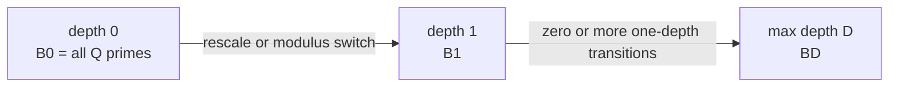
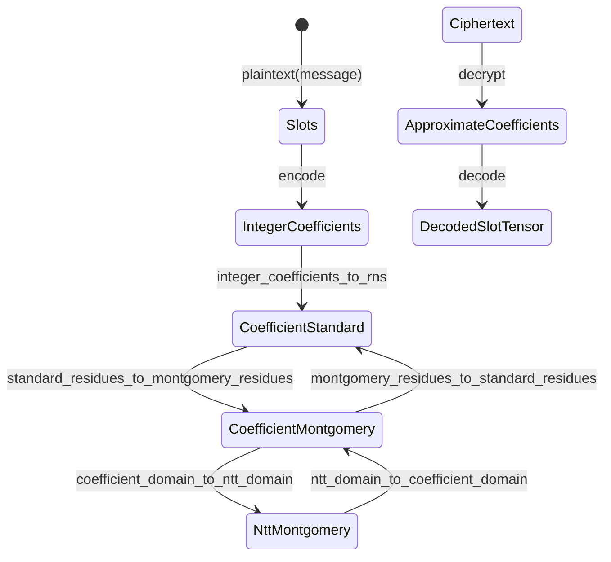
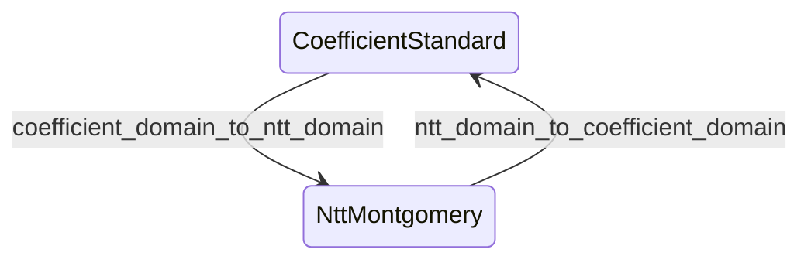

# Value-state transitions

A CKKS value in FHElium carries a set of independent state axes. Each state-transition API changes the axes named by its documented transition and preserves every other axis, except where the ciphertext representation invariant couples polynomial domain and residue representation. This page defines the axes, their valid combinations, the scale and depth coordinates, and the primitive representation transitions. The arithmetic effects of evaluator operations, including multiplication, rescale, modulus switching, and scale reinterpretation, are defined in [Evaluator operation transitions](evaluator-operation-transitions.md).

## Value-state axes

| Axis | Values | Responsibility |
| --- | --- | --- |
| Plaintext representation | `slots`, `integer_coefficients`, `approximate_coefficients`, `rns` | Identifies the semantic or arithmetic payload representation |
| Polynomial domain | `coefficient`, `ntt` | Distinguishes polynomial coefficients from NTT evaluations |
| Residue representation | `standard`, `montgomery` | Distinguishes ordinary residues from Montgomery residues |
| Modulus basis | `Q`, `QP` | Selects the active Q rows or the active Q rows followed by the auxiliary P rows |
| Depth | Integer in `[0, max_depth]` | Selects the active Q basis $B_d$ |
| Prime rows | Ordered `prime_ids` | Maps every dense limb row to one configured prime |
| Scale | Positive finite binary64 | Records the actual CKKS scale of the value |
| Component count | Two or three for ciphertexts | Records the current secret-key polynomial degree |
| Placement | CPU or CUDA device | Identifies storage location |

Valid value states and operation contracts constrain the combinations of these coordinates:

- polynomial domain and residue representation are separate coordinates for plaintexts and coupled for ciphertexts;
- modulus basis and depth are separate coordinates: depth selects the active Q basis, basis selects Q or QP, and `prime_ids` records the resulting rows;
- depth and scale are separate coordinates: depth identifies a basis position, and scale records the encoded magnitude;
- placement changes storage location while preserving the represented polynomial and CKKS message.

Operands of one operation must also come from compatible CKKS parameters; the application retains parameter provenance for runtime values.

## Scale coordinate

A plaintext or ciphertext with actual scale $\Delta$ represents an approximate message whose encoded polynomial has been multiplied by $\Delta$. `value.scale` stores this number. **Scale bits** means $b_\Delta=\log_2\Delta$; “scale 40” means $\Delta\approx2^{40}$.

`config.scale_at(d)` is the default scale $\Delta_d$ of depth $d$, and `config.scales` lists the default scale of every depth. `engine.plaintext`, `engine.encode`, and `engine.encrypt_message` use $\Delta_d$ of the requested depth when their `scale` argument is `None`. Once a value exists, its `scale` field is the actual scale used by subsequent arithmetic and decoding.

Every public scale entry point and value constructor requires a value representable as a finite Python `float` with

$$
0 < \Delta(v) < \infty.
$$

NaN, infinity, zero, negative values, booleans, and strings raise `InvalidScaleError`. A scale product or quotient that leaves the finite-positive range is rejected at the operation that produces it.

## Depth coordinate

The configuration assigns each depth $d$ an active Q basis $B_d$, a set of Q prime IDs with $B_0$ containing every Q prime; [Configuration and modulus chain](context-and-modulus-chain.md) defines the chain. A complete Q value at depth $d$ satisfies

```python
value.prime_ids == engine.config.q_prime_ids(value.depth)
```

and a QP value at the same depth appends the P prime IDs of its layout. Public value creation accepts depths in `[0, engine.max_depth]`. One-depth transitions such as `rescale_to_next_depth` and `mod_switch_to_next_depth` require a following depth, so a value at depth $d$ has

$$
\mathtt{engine.depth\_remaining(value)}=\mathtt{engine.max\_depth}-d
$$

remaining one-depth transitions. Depth records the active basis; it does not count executed multiplications or rescale calls, and several multiplications may precede one rescale when the remaining modulus and precision permit that schedule.



## Plaintext representations

A plaintext owns one top-level `representation`. `integer_coefficients` and `approximate_coefficients` are coefficient-domain representations without residue representation, modulus basis, or prime rows. Only `representation="rns"` owns the RNS axes: polynomial domain, residue representation, modulus basis, and `prime_ids`.

Polynomial domain and residue representation are separate plaintext transitions. The supported RNS plaintext states are:

```text
(coefficient, standard)
(coefficient, montgomery)
(ntt, montgomery)
```

NTT data uses Montgomery residues. A coefficient-domain plaintext can move between standard and Montgomery residues without an NTT.



Decryption produces finite binary64 `ApproximateCoefficients` for decoding. `DecodedSlotTensor` is the Tensor returned by `decode` on the plaintext's device, or on the device given by `device=`.

## Ciphertext state coupling

Ciphertexts have two arithmetic states:

```text
(coefficient, standard)
(ntt, montgomery)
```

A ciphertext domain transition therefore also converts residues:



`coefficient_domain_to_ntt_domain` applies a forward NTT and converts standard residues to Montgomery form; `ntt_domain_to_coefficient_domain` applies the normalized inverse NTT and returns standard residues. Both preserve the ring element, component count, depth, scale, Q/QP basis, and `prime_ids`. The shared method names identify the polynomial-domain axis being changed; the input type determines whether residue representation is preserved, as for plaintexts, or follows the ciphertext coupling.

Which arithmetic state each evaluator operation consumes and produces is listed in [Evaluator operation transitions](evaluator-operation-transitions.md#state-requirements-by-operation).

## Primitive transitions

| API | Accepted source | Target | Preserved state |
| --- | --- | --- | --- |
| `integer_coefficients_to_rns` | `integer_coefficients` plaintext | RNS `(coefficient, standard)` plaintext | Depth, scale, polynomial; the basis is an argument |
| `standard_residues_to_montgomery_residues` | RNS `(coefficient, standard)` plaintext | RNS `(coefficient, montgomery)` plaintext | Domain, depth, scale, basis, `prime_ids` |
| `coefficient_domain_to_ntt_domain` | RNS `(coefficient, montgomery)` plaintext | RNS `(ntt, montgomery)` plaintext | Residue form, depth, scale, basis, `prime_ids` |
| `coefficient_domain_to_ntt_domain` | `(coefficient, standard)` ciphertext | `(ntt, montgomery)` ciphertext | Components, depth, scale, basis, `prime_ids` |
| `ntt_domain_to_coefficient_domain` | RNS `(ntt, montgomery)` plaintext | RNS `(coefficient, montgomery)` plaintext | Residue form, depth, scale, basis, `prime_ids` |
| `ntt_domain_to_coefficient_domain` | `(ntt, montgomery)` ciphertext | `(coefficient, standard)` ciphertext | Components, depth, scale, basis, `prime_ids` |
| `montgomery_residues_to_standard_residues` | RNS `(coefficient, montgomery)` plaintext | RNS `(coefficient, standard)` plaintext | Domain, depth, scale, basis, `prime_ids` |

The accepted-source column is the caller contract. Value construction rejects invalid state combinations; transition methods and Backend implementations do not repeat source-metadata validation and do not reject a valid object that already declares the target state. Compile may retain unknown state until analysis or lowering, and state-flow analysis reports conflicts between inferred and represented state. A caller that transforms heterogeneous states inspects the relevant state field and chooses a transition whose source state matches.

Functional forms allocate independent output storage. An underscore-suffixed form, where provided, mutates the source object and returns that object:

```python
ntt = engine.coefficient_domain_to_ntt_domain(coefficient)
engine.coefficient_domain_to_ntt_domain_(coefficient)
```

## Operation-oriented plaintext preparation

Two APIs name an arithmetic role and compose the required primitive transitions:

```python
addition_operand = engine.prepare_plaintext_for_addition(encoded)
ntt_addition_operand = engine.prepare_plaintext_for_addition(
    encoded, polynomial_domain="ntt"
)
multiplication_operand = engine.prepare_plaintext_for_multiplication(encoded)
```

They are equivalent to the primitive compositions

```python
addition_operand = engine.standard_residues_to_montgomery_residues(
    engine.integer_coefficients_to_rns(encoded)
)

ntt_addition_operand = engine.coefficient_domain_to_ntt_domain(
    addition_operand
)

multiplication_operand = engine.coefficient_domain_to_ntt_domain(
    engine.standard_residues_to_montgomery_residues(
        engine.integer_coefficients_to_rns(encoded)
    )
)
```

and may reuse their newly allocated intermediate storage. Both accept `modulus_basis="QP"` to prepare the operand over the auxiliary basis.

## Transitions on other axes

Depth, scale, component count, key relations, and placement change through evaluator operations whose source and target values depend on runtime state:

| Axis or relation | APIs | Effect |
| --- | --- | --- |
| Depth and scale | `rescale_to_next_depth` | Replaces $B_d$ by $B_{d+1}$ and divides actual scale by the rescale ratio |
| Depth | `mod_switch_to_next_depth`, `mod_switch_to_depth` | Moves to the target depth's basis; preserves scale when the target basis is contained in the source basis |
| Scale metadata | `reinterpret_at_scale` | Preserves residues and replaces the recorded scale |
| Component count | `relinearize` | Converts CT3 to CT2 through key switching |
| Key relation | `switch_key`, `conjugate`, `rotate_with_key`, `rotate_many_with_keys`, `rotate_by_step` | Applies a key-switching relation while preserving depth, scale, Q rows, and CT2 shape |
| Placement | `value.to(device)` | Moves storage while preserving mathematical state |

[Evaluator operation transitions](evaluator-operation-transitions.md) gives the equations and operand requirements of each row. Ciphertext Q-to-QP digit extension and QP-to-Q ModDown occur inside key-switch and bootstrapping arithmetic; no public ciphertext ModUp method exists. Plaintext RNS materialization and preparation select Q or QP as their target basis.

## CRT reconstruction

`ntt_domain_to_coefficient_domain` preserves the RNS payload form, modulus basis, and prime rows; it does not reconstruct an integer coefficient from the RNS rows. An `RNS -> integer_coefficients` operation would need to specify the composite modulus, representative interval, output numeric type, and integer or approximate reconstruction semantics. Decryption instead produces bounded `approximate_coefficients` for decoding, and the semantic round trip is

```text
decrypt -> decode -> encode -> encrypt
```

## Related concepts

- [Configuration and modulus chain](context-and-modulus-chain.md)
- [Value model and identity](value-model-and-identity.md)
- [Evaluator operation transitions](evaluator-operation-transitions.md)
- [Key lifecycle](key-lifecycle.md)
