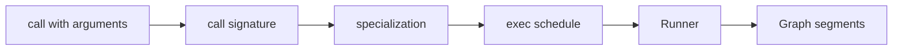

# Compiled execution

Compiled execution runs a captured and transformed computation as an exec schedule on a native Runner. A compiled callable holds one *specialization* per set of input conditions; each specialization owns a linked executable whose schedule a Runner executes, optionally through CUDA Graphs of its segments. This page defines the schedule, its storage classes, Graph segments, result ownership, and the storage shared between compiled functions.

## Specialization, schedule, and Runner

A *call signature* describes the arguments: shape, dtype, and device of Tensors, CKKS state of ciphertexts and plaintexts (depth, scale, domain, basis, components), and the values of Python scalars. Calls with equal signatures use the same specialization; Tensor contents do not enter the signature. Linking turns the transformed Program into an *exec schedule*: buffers with storage classes and static layouts, host registers for index arithmetic, and instructions that call operators, launch compiled kernels, create views, copy, run collectives, call other schedules, and branch or loop on host registers. A *Runner* executes the schedule from native code; Python takes part only where a schedule instruction calls a Python implementation.

Materials, such as keys, encoded plaintexts, and numerical tables, are bound to schedule buffers once and stay at their addresses across executions. Changing a material's contents in place is visible to later executions.

## Storage classes

| Class | Lifetime | Contents |
| --- | --- | --- |
| `input` | One execution | Argument Tensors, read where the caller placed them. |
| `material`, `state` | Bound once | Keys, plaintexts, tables, and live resource state. |
| `arena` | One execution, at a fixed offset | Temporaries that are neither returned nor aliased by a result. |
| `output` | Until the caller releases the result | Results; with Graph segments, at a fixed address in the Runner's output region. |
| `internal` | Until the last use within its block | Results of operator calls that the caching allocator provides. |

Arena buffers occupy byte offsets of one device buffer. Two buffers share an offset range only when their lifetimes do not intersect, so the arena size is the peak of simultaneously live temporaries rather than their sum.

## Shared arena

Compiled functions on one CUDA device keep their temporaries in one shared arena, sized to the largest requirement among them, and use one CUDA Graph pool. Executions on the shared arena are ordered on the device. An execution that starts while another execution on the arena has not returned, such as a compiled function called from a Python implementation inside a schedule or from another thread, uses a private arena. The device memory held by the shared arena and the Graph pool is the device's *compiled execution memory*.

## Graph segments

A *segment* is a maximal run of capture-safe instructions at the top level of a schedule, where a loop or branch counts as one instruction. Kernel launches, copies, views, zeroing, operator calls on Tensors of one CUDA device, and collectives on CUDA buffers are capture-safe; Python calls, CPU operations, and operators that read device values on the host end a segment.

A specialization executes its schedule directly on its first execution, captures each segment as a CUDA Graph on its second, and replays the Graphs afterwards, with separate Graphs for each grad, inference, and autocast context. A CUDA Graph policy selects how each segment uses its Graph:

| Policy | Rule |
| --- | --- |
| Automatic | The segment compares the device time of its first direct execution with the median device time of the three replays after its capture, keeps its Graph when the replay is shorter, and otherwise releases it and executes directly from then on. |
| Always | Every segment keeps its Graph. |
| Never | Every execution is direct. |

The decision belongs to the segment and persists when the segment is captured again. Specializations with host-resident Tensor inputs or inputs that require gradients, and specializations whose first capture failed, execute directly; the record's fallback reason for host inputs is `Graph execution requires Tensor inputs on one CUDA device`.

## Results and their storage

A Graph result occupies the Runner's output region and is returned without a copy. Before the next execution of the same specialization writes that region, each result of the previous execution that the caller still references, directly, through a view, or through a CKKS value, moves to newly allocated memory, and its Tensor storage is redirected there. A result therefore stays valid while the caller holds it, its data pointer may change at the next execution, and a result released before the next execution costs no copy.

A result passed to another compiled function on the same device is read in its output region. A segment that reads storage of another Runner keeps up to four captured variants, one for each set of input addresses; other live-in Tensors of a segment are staged into storage its Runner owns.

## Placement

Placement in compiled execution is part of the dataflow. A transfer captured from the source executes on every execution, and every other operation executes on the device of its operands. Compilation neither inserts nor removes transfers, and argument devices are part of the call signature. Inside a compiled function, `.to(device)` on a ciphertext or on an evaluation-key argument (`KeySwitchKey`, `RotationKey`, `RelinearizationKey`) is a transfer of the schedule. `.to(device)` on a plaintext argument belongs to plaintext preparation, which runs before the schedule when the argument changes.

## Transfers, streams, and the CPU lane

A compiled schedule issues its host-device copies on dedicated copy streams instead of the compute stream. Each transfer is issued, in program order, at the earliest position after its dependencies at which the device memory the schedule needs, its arena plus the other device buffers the schedule allocates, exceeds that of the schedule without moved transfers by at most the size of its largest transfer; a transfer whose earlier issue would need more memory is issued as soon as freed memory permits. Device work waits on the copy's event before it reads, writes, or releases the transferred buffer, a device-to-host copy starts after the last writer of its source, and host consumers wait for it. Host buffers that the schedule allocates are pinned. Caller host buffers are used where they lie: pinned buffers copy asynchronously, and pageable buffers are copied correctly but staged by CUDA within the copy call, so pinned arguments (`Tensor.pin_memory()`) are required for transfer and compute to overlap. Collectives can run on a communication stream outside Graph segments, which then end at each collective; collectives keep their program order relative to each other, so every rank issues them identically.

In a compiled schedule, runs of CPU-only instructions execute as tasks on the process's *CPU lane*: one persistent worker thread shared by every compiled schedule of the process, which runs tasks in issue order. A task is joined before its results are read. CPU operations inside a task use the configured intra-op thread count, and the persistent thread keeps its OpenMP team, so a task runs as fast as the same stage on the calling thread. Copy streams, communication streams, events, and CPU tasks are part of the schedule and are exported with it.

## Collectives

A rank-local schedule contains its collectives as instructions on a bound process group, with rank and group size read from that group when the schedule runs; the group size is part of the captured group type. Every rank executes the same sequence of collectives per execution. Collectives on the compute stream belong to CUDA Graph segments, and a segment containing a collective on a process group that cannot be captured executes directly.

`fhelium.distributed.all_reduce_ciphertext` and `reduce_ciphertext` in a compiled function are captured as one ciphertext all-reduce over the captured process group; for `reduce_ciphertext` every rank receives the sum, and the destination argument selects the rank whose caller uses it. The default pipeline lowers the all-reduce to an `all_gather` of the $P$ rank ciphertexts followed by $P-1$ modular additions in rank order, so every rank computes a bitwise identical sum; the gather buffer holds $P$ ciphertexts per rank. `broadcast_ciphertext` is not captured.

A schedule depends on the process rank only when the captured function reads `torch.distributed.get_rank()` or the source cannot be identified. The persistent cache key and an exported artifact then record the rank, and loading on another rank fails; other schedules run on any rank.

## Exported execution

An exported artifact stores each specialization's schedule twice, as planned without and with Graph segments, together with its kernel images, constants, and the recipes of its tables. A loaded artifact executes through the same Runner with the same storage classes, segments, and result rules; keys and process groups are bound by the loading process.

## Numerical agreement with Eager

Compiled results equal the Eager results bitwise unless rotation hoisting groups rotations: hoisted key switching rounds in a different order. Both results are deterministic and lie within the CKKS error of the computation.

## Manual Graph capture

`CudaGraphProgram` captures an arbitrary callable, such as Eager code or a compiled function constructed without Graphs, under application control. It stages each call's inputs into fixed input buffers, replays one Graph, and returns retained output storage that the next replay overwrites unless an owned copy is requested. One instance serializes its replays, and `CudaGraphPool` shares temporary storage among sequentially replayed instances on one device. Encryption, key generation, I/O, and decisions that vary per call stay outside a manual capture, as they stay outside compiled functions.

## Related concepts

- [Value signatures and buffers](signatures-and-buffers.md)
- [Residency lifetimes](residency-lifetimes.md)
- [Communication semantics](../distributed/communication-semantics.md)
- [CKKS cost model](../performance/cost-model.md)
