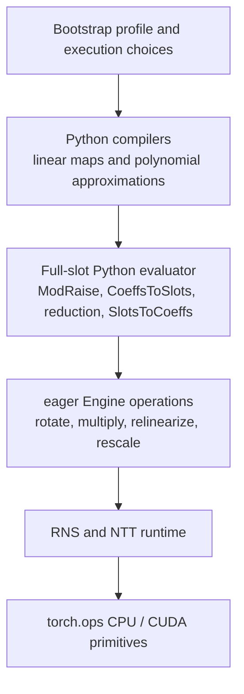

# CKKS bootstrap internals

This page specifies the mathematical, value-state, and actual-scale invariants of the built-in full-slot composition executed through `fhelium.eager.Engine`.

## Evaluator stack



`fhelium.experimental.bootstrap` compiles diagonal linear maps and polynomial approximations, then evaluates those stages through the ordinary `fhelium.eager.Engine`, `Ciphertext`, NTT, and native-operator stack.

`fhelium.experimental.bootstrap.presets` constructs component profiles. Compiler and evaluator objects are paired by protocol: a compiler's stage representation must be understood by its matching evaluator, and their `required_depths` reports must match execution. Compiled diagonals, rotation decompositions, and ModRaise constants are Python/runtime resources; the dense arithmetic reaches `fhelium_rns_ops`, `fhelium_ntt_ops`, and `fhelium_ckks_ops` through the engine.

The source tree follows those responsibilities:

- `full_slot.py` configures the composition, defines key requirements and entry/output-scale transitions, and owns ordinary-call caches;
- `_core.py` evaluates the normalized ModRaise → CoeffsToSlots → periodic reduction → SlotsToCoeffs algorithm and binds each prepared callable's components, keys, input signature and material lifetime;
- `arithmetic.py` defines `BootstrapArithmetic`, which applies depth-dependent scale targets and representation choices through one Engine and a shared constant table;
- `linear/` separates the diagonal value, direct/BSGS evaluators, radix-2 compiler, and key-aware execution of compiled stages;
- `polynomial/` separates approximation values and interpolation from power-basis and Chebyshev evaluation schedules;
- `reduction/` owns the cosine periodic reduction;
- `structural.py` defines entry-coordinate adaptation and the centered or encapsulated raising components; Crypto prepares the key relations and RNS executes the underlying integer arithmetic;
- `presets/` contains only caller-visible circuit assemblies.

Component `evaluate()` methods receive a `BootstrapArithmetic` instance. Nested periodic and polynomial evaluations share its target-scale schedule, representation mode and constant table. Preparation fills that table; prepared execution requires existing entries.

## Notation

Let:

- $N=2^{\mathtt{logN}}$ and $S=N/2$;
- $\Delta_0$ be `bootstrap.input_scale`, defaulting to `config.default_scale`;
- $D$ be `engine.max_depth`;
- $G_{D-1}$ be the entry Q group and $M_{D-1}=\prod_{q\in G_{D-1}}q$;
- $q_b$ be the product of the source Q suffix selected by `source_depth`;
- $Q_d$ be the ordered Q basis recorded by a ciphertext's `prime_ids` at depth $d$;
- $C$ and $T$ be the unscaled CoeffsToSlots and SlotsToCoeffs maps;
- $B$ be `modular_reduction.input_bound`;
- $F$ be `modular_reduction.fused_input_divisor`, either $1$ or $B$.

The radix-2 compiler convention is

$$
T(C(a))=Sa.
$$

A plaintext reference round trip therefore compiles $C$ with `scale=1.0` and $T$ with `scale=1.0 / S`.

## Entry and structural-base transition

The following entry equations describe the default preceding-group entry. With `input_depth=source_depth`, entry uses the existing source-basis payload and records its actual-scale ratio directly. A custom `source_depth` selects an ordinary Q suffix rather than a private depth.

The input is a two-component coefficient-domain, standard-residue Q ciphertext at `bootstrap.input_depth`, which defaults to `max_depth - 1`. Its dense tensor has axes `[component, *batch, limb, coefficient]`, coefficient extent $N$, and limb order exactly equal to `prime_ids`. At that depth the Q basis contains the rows of $G_{D-1}$ followed by the terminal group.

Entry preparation chooses an integer

$$
k=\max\left(1,\left\lceil M_{D-1}\Delta_0/\Delta_{in}\right\rceil\right).
$$

Multiplying both the ciphertext residues and scale by $k$ preserves its message. The identity case $k=1$ returns the input directly. This avoids an encoded-one plaintext whose small encoding scale could destroy precision. Nearest group rescale then yields terminal scale $\Delta_b=k\Delta_{in}/M_{D-1}$.

The fixed transform circuit operates on the coordinate $u=(\Delta_b/\Delta_0)m$: a separate metadata view gives the terminal payload scale $\Delta_0$. After refreshing $u$, the output scale is multiplied by $\Delta_b/\Delta_0$ to recover coordinate $m$. These two coordinate changes compensate one another; they are not message-preserving rescale operations. C2S/S2C coefficients and their cached materials are independent of the input scale. No approximate floating-point cache-key rounding or automatic material eviction is needed.

### Arithmetic scale schedule

`BootstrapArithmetic.target_scales` holds depth-dependent targets $s_d$. Starting from $s_D=\Delta_0$, the owner computes backward

$$
s_d=\sqrt{M_d s_{d+1}}.
$$

Thus a ciphertext product at scale $s_d$ naturally rescales to $s_{d+1}$. Scalar, polynomial-coefficient, and diagonal plaintexts use scale $M_d s_{d+1}/\Delta_{in}$, so their products also reach $s_{d+1}$. Every rescale retains the quotient's actual scale. Constants added to a ciphertext are encoded at that ciphertext's scale; prepared-material caches include the selected encoding scale.

Independent polynomial basis nodes use an arithmetic view anchored at the input's actual scale, $t_d=\Delta_{in}$, and propagate $t_{j+1}=t_j^2/M_j$. Copies of the input used in Chebyshev subtraction follow the same recurrence. Coefficient products connect those basis values to the chosen output scale. Paterson–Stockmeyer coefficient accumulators use a common scale multiple of the basis schedule, so multiplication by an unscaled basis power and addition of the next coefficient group remain consistent.

A basis scale can become too small after repeated products, requiring a scalar plaintext coefficient beyond the signed-integer encoding range. Material preparation reports that range failure instead of allowing integer overflow. A caller can first use `arithmetic.advance_depth(input)` to place the value on the arithmetic target schedule, accounting for that additional transition. The evaluator does not silently consume an extra depth.

The terminal depth remains part of the general CKKS chain. Bootstrap owns this entry requirement and uses an ordinary Engine rescale to reach it.

## Modulus raising

### Centered extension

For every ciphertext component and polynomial coefficient, centered ModRaise chooses the unique source representative

$$
\widetilde c\in
\left[-\left\lfloor\frac{q_b}{2}\right\rfloor,
       \left\lfloor\frac{q_b}{2}\right\rfloor\right]
$$

consistent with the residue modulo $q_b$, and emits $\widetilde c\bmod q_i$ for every $q_i\in Q_{\ell_r}$, where $\ell_r$ is `modulus_raise_target_depth`. It is a component-wise centered basis extension, not rescale or modulus restriction.

The transition is

```text
depth source_depth, prime_ids Q_source, coefficient, standard, Q, two components, scale Delta_0
  ->
depth ell_r, prime_ids Q_ell_r, coefficient, standard, Q, two components,
scale Delta_0
```

Data axes and batch shape are preserved; the limb extent changes from `len(Q_source)` to `len(Q_ell_r)`. Execution uses the shared centered mixed-radix basis-extension operation, including source bases wider than a single hybrid digit. The slow `reference_centered_basis_extend()` oracle reconstructs with Python integers and returns a tensor shaped `[*batch, target_limb, coefficient]` in standard residues on the input device.

### Sparse-secret encapsulation

Let $(d_0,d_1)$ be the low-basis result of switching from main secret $s$ to intermediate secret $t$. Its digit keys satisfy $b_j+a_jt=P_{low}E_js+e_j$. Centered extension lifts $d_0$ and $d_1$ into the return basis. With guard prime $q_\star$, return auxiliary product $P_{return}$ and $D_r=q_\star P_{return}$, the return hint satisfies

$$
H_0+H_1s=D_rt+e.
$$

The output components on target Q are

$$
c'_0=\widetilde d_0+\operatorname{Round}_{D_r}(\widetilde d_1H_0),\qquad
c'_1=\operatorname{Round}_{D_r}(\widetilde d_1H_1),
$$

where $\operatorname{Round}_{D_r}$ denotes the selected rounded quotient by the complete guard/auxiliary product, reduced into target Q. Its evaluation uses NTT key products, inverse transforms and the shared trailing-basis quotient. The main-secret relation is restored before Fourier evaluation, with the added key-switch and quotient noise. Source and target depths, batch shape and actual scale follow the registered CKKS operation's state transition.

`create_secret_key(hamming_weight=h)` selects uniform support without replacement and independent signs. Crypto preparation converts both supplied secrets into the low and return numerical bases and creates ordinary `KeySwitchKey` values. `EncapsulatedModRaise` binds those evaluation keys. Secret weight and auxiliary bases are caller choices; the associated [security model](security#sparse-secret-encapsulation) covers their joint publication.

### Numerical preparation and execution

Bootstrap key switches default to `modup_method="exact"`. `"normalized_crt"` and `"crt"` select the normalized and raw linear CRT lifts defined in [RNS and NTT architecture](rns-and-ntt.md#linear-crt-lifts). Their source residues agree with the exact lift, but their integer representatives change evaluation-key noise. Select them with the auxiliary product, effective digit supports and actual scales, then validate complete refresh error. A linear evaluator can override the arithmetic lift choice; encapsulation's low-basis switch uses exact extension.

NTT policy controls numerical table layout independently of key inventory membership. Compact int32 policies can use Shoup twiddles, with the storage and fusion constraints described in [compact NTT plans](rns-and-ntt.md#compact-plans). Montgomery twiddles remain the default. Select a table layout using complete-workload latency and retained table storage.

Centered CRT extension and trailing-prime quotients are RNS operations. CKKS Backend implementations compose the low key switch, centered extension, return key product and quotient from Tensor operands. Eager owns ciphertext state transitions and key placement; Compile preserves live key/table operands and exposes both whole-operation execution and RNS/NTT lowering. Secret sampling, basis conversion and guard-scaled hint generation belong to crypto preparation. Bootstrap selects a modulus-raising component and combines it with Fourier transforms, polynomial reduction and its actual-scale schedule.

## Cyclic-diagonal linear maps

A `DiagonalLinearTransform` stores one CPU `complex128` vector $d_k$ with axes `[slot]` for each signed rotation offset $k$. It represents

$$
L(x)=\sum_kd_k\mathbin{\odot}\operatorname{Rot}_k(x),
$$

where `Rot_k` matches `numpy.roll(x, k)`. `reference(values)` accepts exactly one vector of shape `[slot]`, returns the same shape, and performs neither CKKS encoding nor scale or depth simulation.

The direct evaluator rotates, plaintext-multiplies, and sums all diagonal terms, then rescales once. BSGS writes $k=g+b$ and computes the equivalent identity

$$
\operatorname{Rot}_g\left(
 \operatorname{Rot}_b(x)\mathbin{\odot}\operatorname{Rot}_{-g}(d_{g+b})
\right)
=
\operatorname{Rot}_{g+b}(x)\mathbin{\odot}d_{g+b}.
$$

`giant_step_reduction="aggregate"` streams the final giant key products into QP and accumulates each ordinary ciphertext component after multiplying by P. If $z_g$ denotes a complete unrounded contribution and $M_d$ the product of the dropped Q depth group, the result is $\lfloor(\sum_g z_g+h)/(PM_d)\rfloor\bmod Q_{d+1}$, where $h=(PM_d-1)/2$ for nearest rounding. One inverse QP NTT and one quotient tail finish the stage. The independent strategy instead rescales and key-switches every giant before Q accumulation. The two schedules implement the same ideal map and output-state transition but have different rounding errors.

`backend.ckks.rotation` owns the streaming Tensor accumulator and whole-operation implementation. `RotationSumOp` exposes the same numerical operation to Compile, with live source, key and table operands. Its logical lowering exposes per-key products to existing RNS/NTT fusion and ends in `RoundedTrailingQuotientOp`. `ScaleAndPadRowsOp` supplies the P-scaled ordinary Q contribution with zero P rows. The quotient tail uses the complete Q group product, including multi-prime depth groups.

`AggregateRotationSumsPass` optionally recognizes compatible SSA rotation/add trees and rescale transitions. The pass preserves unrelated users and rejects unknown effects, partial required state, mismatched table bindings and caller-assigned operations. It changes rounding, so it is not enabled by the default lowering recipe. Compose it with `default_lower_and_fuse_pipeline(...).before("rotation-hoisting", AggregateRotationSumsPass())`. The pass docstring records measured Graph and non-Graph performance conditions.

`DiagonalBSGSEvaluator.rotation_schedule` controls the lifetime of shared rotations and group accumulators. `group_major` materializes the distinct baby rotations and computes up to `group_batch_size` group sums together. Each block is completed through INTT, rescale and giant rotations before producing the next block. A rotation is removed from the invocation's map after its last block consumer. `baby_major` yields one baby result at a time and updates the live group accumulators in place. With direct baby keys, the generator uses the same Backend hybrid-digit preparation and per-key product/ModDown as hoisted rotate-many, but releases each yielded result before generating the next one. Composed key inventories retain their ordinary successive keyed rotations.

The default group batch contains at most 16 groups, preserving the native 16-term/16-group weighted-sum specialization when that shape is present. `group_batch_size=1` selects one group at a time; callers may choose intermediate extents to trade shared-load execution against temporary storage. The default `auto` schedule selects baby-major when the stage has fewer giant groups than distinct baby rotations, and group-major otherwise. The groups and baby offsets come from the caller's BSGS partition; `schedule_for(stage)` exposes the decision, and callers can force either traversal. The comparison concerns two-component ciphertext storage of equal shape within one stage. It does not include key-switch scratch, encoded diagonals, or kernel-launch costs. Both traversals feed the same selected giant-step quotient schedule in increasing-offset order.

Full-slot execution releases entry coordinates and transform intermediates after branch splitting, and releases the original branch pair after packing a batched reduction. The binary-decomposition Chebyshev evaluator counts recurrence and coefficient consumers before execution. Basis nodes remain cached through their final consumer, while coefficient products are accumulated by depth as soon as their basis node is available; each depth group still receives one shared rescale. Monomial multiplication expresses the negacyclic shift, sign correction and modular reduction as functional Tensor operations. Prepared diagonals and scalar constants remain governed by the callable's retention settings.

For either evaluator, diagonal plaintexts are unbatched `[limb, ntt_index]` tensors in NTT/Montgomery form over the active Q basis. They broadcast over ciphertext batch axes. At depth $d$ and input scale $\Delta$, their encoding scale is $M_d s_{d+1}/\Delta$. One group rescale therefore returns scale $s_{d+1}$, advances depth once, and removes all rows in that group. The output has two coefficient-domain standard-RNS components.

## CoeffsToSlots, branch split, and coordinates

Construction compiles numerical factors

$$
\alpha_C=\frac{\Delta_0}{q_bF},\qquad
\alpha_T=\frac{q_b}{2\Delta_0}.
$$

The factors multiply diagonal values; they are distinct from the diagonal plaintext's encoding scale selected by `BootstrapArithmetic`. Let $a$ denote the coefficient-coordinate value represented by the centered-raised ciphertext at metadata scale $\Delta_0$. Define

$$
w=\frac{\Delta_0}{Sq_b}C(a),\qquad
r_{\rm R}=2\operatorname{Re}(w),\qquad
r_{\rm I}=2\operatorname{Im}(w).
$$

Slot normalization contributes a factor $1/S$, either after CoeffsToSlots or in the selected forward stage. The following coefficient multiplication consumes one depth for arithmetic scale alignment; its numerical factor is one when normalization has already been folded into the diagonals. The represented complex coordinate is $w/F$.

Conjugation gives $\overline{w}/F$. Addition exposes $2\operatorname{Re}(w)/F$; subtraction exposes $2i\operatorname{Im}(w)/F$. Under the full-slot cyclotomic order used by the generator-5 profile, multiplication by $X^{3S}$ converts the latter to $2\operatorname{Im}(w)/F$. Therefore:

- if normalization is not fused, $F=1$ and the reducers receive raw coordinates $r_{\rm R}$ and $r_{\rm I}$;
- if normalization is fused, $F=B$ and they receive normalized coordinates $x_{\rm R}=r_{\rm R}/B$ and $x_{\rm I}=r_{\rm I}/B$.

Conjugation, branch addition/subtraction, and monomial multiplication preserve depth, actual scale, two components, Q basis, domain, residue representation, and `prime_ids`.

## Periodic reduction

The raw coordinate is $r$. The normalized polynomial coordinate is a distinct object

$$
x=r/B\in[-1,1].
$$

The built-in cosine reducer targets

$$
\rho_B(x)=\frac{\sin(\pi Bx)}{\pi}
          =\frac{\sin(\pi r)}{\pi}.
$$

For $r=2k+\epsilon$, the periodic target is $\sin(\pi\epsilon)/\pi\approx\epsilon$. Neither a reducer nor a factory can inspect encrypted $r$, so $|r|\le B$ is a caller-established precondition.

The methods consume the following inputs:

- `reference(values)` always consumes normalized $x$ and applies the fitted polynomial and recurrence directly;
- non-fused `evaluate(...)` consumes raw $r$ and spends one scalar-multiply depth computing $x=r/B$;
- fused `evaluate(...)` assumes the caller already supplied $x$.

### Cosine recurrence

For $R=$ `double_angle_iterations`, the fitted seed is

$$
z_0(x)\mathrel{\approx}
\pi^{-1/2^R}
\cos\left(\frac{\pi Bx}{2^R}-\frac{\pi}{2^{R+1}}\right),
$$

followed by

$$
z_j=2z_{j-1}^2-\pi^{-1/2^{R-j}},\qquad j=1,\ldots,R.
$$

For a nonzero `seed_shift` $u=x+\sigma$, the fitted seed uses the corresponding phase correction so evaluating the polynomial at $u$ preserves the same periodic target in $x$. The 3/30 profile uses $\sigma=-1/64$, making its degree-30 seed even. `EvenChebyshevEvaluator` evaluates $p(u)=q(T_2(u))$ through a degree-15 inner polynomial; constants with trailing zero coefficients delegate directly to the inner constant schedule.

The final value approximates $\rho_B(x)$. Every square uses ciphertext multiplication, relinearization, and group rescale with actual scale retained.

The reduction output is a functional two-component, coefficient-domain standard-RNS Q ciphertext at input depth plus `required_depths`, unchanged batch shape, and the corresponding active `prime_ids`. Its actual scale follows the arithmetic schedule and quotient scales; it need not equal $\Delta_0$.

## Polynomial basis and evaluator requirements

`PolynomialApproximation.coefficients` is always ascending degree:

$$
p(x)=\sum_{n=0}^{d}a_nx^n
\quad\text{or}\quad
p(x)=\sum_{n=0}^{d}a_nT_n(x).
$$

`ChebyshevInterpolator` maps a physical coordinate $t\in[a,b]$ to

$$
x=\frac{2t-(a+b)}{b-a}.
$$

Its returned coefficients are functions of $x$, even though `domain` records $[a,b]$. `evaluate_plaintext()` and the homomorphic evaluators do not apply this affine normalization. The caller must provide the basis coordinate and account for any depth required to compute it.

`BalancedPowerEvaluator` uses shared balanced powers. `BinaryDecompositionChebyshevEvaluator` uses

$$
T_{2n}=2T_n^2-1,\qquad
T_{2n+1}=2T_nT_{n+1}-T_1.
$$

These evaluators accept two-component Q ciphertexts in coefficient/standard or NTT/Montgomery form. Ciphertext products use NTT/Montgomery form and produce three components. Immediate products and delayed block accumulators use `Engine.relinearize(..., rescale=True)` to restore two components and consume the next complete Q group with one common quotient. The key is selected at the product depth, and the actual scale is divided only by the dropped Q-group product. The [relinearization equations](multiplication-keyswitch-rescale.md#relinearization) define the combined numerator and independent rounding offsets. `BootstrapArithmetic.retain_ntt` controls whether intermediate products stay in NTT form. `BlockedChebyshevEvaluator` uses the same entry states and exposes its block schedule through `plan()`; its final block products share this transition as described below.

## Recombination, SlotsToCoeffs, and output

After periodic reduction, multiplication of the imaginary result by $X^S$ restores its imaginary placement. Branch addition represents

$$
\rho(r_{\rm R})+i\rho(r_{\rm I}),
\qquad
\rho(r)=\frac{\sin(\pi r)}{\pi}.
$$

The fixed SlotsToCoeffs factor $q_b/(2\Delta_0)$ cancels the branch-split factor for the internal coordinate $u$. Its result initially records the circuit's actual output scale. Multiplying that metadata scale by $\Delta_b/\Delta_0$ then changes coordinates from refreshed $u$ back to $m$.

The output depth is

$$
\ell_{\rm out}=\ell_r+m_C+1+m_\rho+m_T,
$$

where $m_C$ and $m_T$ are the declared CoeffsToSlots and SlotsToCoeffs stage costs and $m_\rho$ is `modular_reduction.required_depths`. The output is a functional two-component coefficient-domain standard-RNS Q ciphertext with unchanged batch axes and `Q_ell_out` `prime_ids`.

## Key provisioning, selection and material ownership

`EvaluationKeySet` retains ordinary `RotationKey`, `RelinearizationKey` and `ConjugationKey` references supplied by an application. Multiple layouts and devices for the same step can coexist. Object identity deduplicates insertion; `remove` and `clear` release inventory references. The consumer's active basis and execution state determine its selection. The application maintains parameter provenance and secret relations.

`required_rotations` is the union of direct or BSGS transform offsets. `key_steps("all_required")` returns direct steps; `key_steps("signed_power_of_two")` returns a standalone signed-power basis; `key_steps("signed_power_of_two_with_baby_steps")` adds direct babies from the actual BSGS partitions. The queries normalize and deduplicate steps, exclude zero and return no key data. `evaluation_key_requirements` additionally reports conjugation and the selected reduction's relinearization requirement. The reduction stage is slotwise and introduces no transform rotations.

`FullSlotBootstrap.create_evaluation_keys(secret_key, into=pool, rotation_key_strategy=..., device=...)` provisions the selected capabilities through Engine primitive factories and returns `pool`. Existing compatible groups are reused by reference. Missing material is chosen across the composition's consumers, accounting for shared steps, active Q coverage and additional key storage. Requested direct-baby hoists constrain newly completed groups to a common stored layout. Already complete mixed coverage is reused without generation and can execute independently; disabling baby hoisting removes that constraint from new generation. A compact layout for one stage is useful only in the context of the resulting shared inventory. Encapsulation's low and return hints are supplied with the raising component.

Selection reads the actual `digit_prime_ids`, ordered `prime_ids`, P basis, ring dimension, residue dtype and device. Independent rotations and composed prefixes can use different stored layouts. Hoisted babies share a decomposition; aggregate giants share the layout of their final key switches. Preparation represents each logical rotation as an ordered tuple of primitive keys. When available baby paths cannot share a hoisted decomposition, the evaluator executes those paths independently. Relinearization selection uses the aligned product's active basis. A stored key's surviving digit supports retain their original Tensor plane indices when execution restricts Q. Fresh key generation can partition the smaller active Q basis independently.

With all execution facts known, rotation groups are ranked by primitive key-switch application count, total active digit applications and bytes of distinct selected key payloads, with insertion order breaking ties. Repeated use of a primitive key contributes repeated applications but one retained payload. Relinearization and conjugation rank by active digits, stored payload and insertion order. This deterministic selection rule operates on represented work and storage; measured latency remains a property of the complete execution. Unknown facts permit only a unique compatible choice.

During material discovery, linear stages, polynomial products and conjugations record the selected key references in ordinary dictionaries. Built-in polynomial and reduction schedules expose their actual relinearization depths, including normalization and delayed products; undeclared custom schedules require full-basis coverage. A directly supplied key is retained for that call; other calls at the same depth keep their inventory-selected keys. A prepared core retains those selections and its encoded materials. Repeated prepared execution reads the dictionaries, and capture passes the selected payloads into ordinary operations. Backend implementations consume actual key/table Tensors. Appending to, removing from or clearing the shared pool does not change a prepared computation; a new preparation chooses from the revised inventory.

Ordinary-call owners retain encoded diagonal and constant dictionaries. Prepared owners additionally retain selected primitive rotation paths and the keys consumed by polynomial products and conjugations. RNS/NTT and modulus-raising numerical tables belong to Engine resource preparation. `clear_cache()` releases the Bootstrap object's ordinary caches. Each prepared owner has its own materials and closes after its Graph users.

`cosine_bootstrap` selects components through its profile argument. The default is a centered 7/44 composition with Blocked evaluation and aggregate quotients. The 3/30 profile selects an even degree-30 seed and a different Fourier schedule; the caller supplies its raising relation and matching scale plan. Construction checks supported entry/target depths, positive finite scales, transform slot counts and sufficient Q depth for the declared component costs. The raw-coordinate range and output precision are properties of the chosen construction and input class.

The 3/30 profile partitions its four coefficient-to-slot stages with power-of-two baby widths derived from each collapsed radix-layer group. If a group contains $w$ layers and $r$ layers remain below it, its rotation unit is $2^r$. The first stage uses a baby width of $2^{\lceil w/2\rceil}$; subsequent stages use $2^{\lceil(w+1)/2\rceil}$ to account for their signed diagonal range. The step is the rotation unit times that width, and traversal is group-major. At $N=65536$, the resulting steps are 8192, 1024, 64 and 4. A supplied coefficient-to-slot evaluator retains its own partition and traversal.

## Block-factorized Chebyshev evaluation

`BlockedChebyshevEvaluator.plan()` owns coefficient factorization, the binary dependency graph, critical-path depth and operation inventory. Descending elimination applies

$$
T_{jm+i}(x)=2T_{jm}(x)T_i(x)-T_{jm-i}(x),\qquad
P(x)=\sum_j A_j(x)T_{jm}(x),\quad \deg A_j<m.
$$

Giants are built from the original coordinate through the binary recurrence. All basis advancement follows one `for_input` scale schedule. Where $s_{d+1}=(s_d s_d)/M_d$, encoded-one advancement selects plaintext scale $s_d$ directly, giving the same binary64 multiplication and division as a basis product.

Let the final depth be $f$, baby scales be $S_k$ and the aligned giant scale at $f-1$ be $G$. Each baby is restricted to depth $f-2$ without changing its scale. Its coefficient plaintext uses scale $p_k=C/S_k$, where the represented products $S_kp_k$ must all equal the common scale $C$. The block's nonconstant terms are accumulated and rescaled once to $A=C/M_{f-2}$; its constant coefficient is then added at scale $A$. Products $A_jT_{jm}$ for $j>0$ have three components at the common actual scale $AG$ and are accumulated before one relinearization and rescale. The $j=0$ block is multiplied by encoded one at plaintext scale $G$ and rescaled. Both paths compute the output scale $(AG)/M_{f-1}$ in the same operation order. Basis advances shared by recurrence and giant consumers reuse one result for each basis index and target depth. This construction consumes the plan's declared depths and handles complex coefficients and messages without a real projection.

The coefficient-scale choice retains the preferred $C$ when every binary64 division and multiplication round-trips to it. Otherwise it derives a common scale from the basis significands and checks the represented products before constructing the block. That scale propagates through the remaining polynomial, double-angle and Fourier operations. Scalar encoding limits apply to each selected coefficient scale and to constants at their addition scale.

The reordered rounding and key switching preserve the polynomial but need not preserve residue arrays or the previous noise realization. The state schedule and approximation error therefore have separate validation obligations.

## Compact scalar materials

A constant slot message has period one. The Engine's compact encoder embeds its polynomial as $a(X^{N/U})$, using $U=2$ for generator5 and $U=4$ for generator3. The actual ring roots, Q rows, scale and stochastic-rounding stream remain those of the Engine. Additions use the ciphertext's current scale and domain; multiplication plaintexts use the arithmetic's scheduled scale and NTT/Montgomery form.

`constant_cache` keys distinguish Engine ownership, scalar value, actual plaintext scale, depth/prime rows, representation, dtype and device. Monomial modulus tables share this owner-aware namespace. The cache stores an encoded rounding sample: first preparation advances the rounding state, reuse does not, and clearing permits new samples. A disabled cache uses device-side scalar message construction that can be warmed and captured without temporary host-list transfers.

Scalar preparation checks `max(abs(real(c)), abs(imag(c))) * scale < 2**63` before signed-integer coefficient conversion. For addition, `scale` is the ciphertext’s actual scale; for multiplication, it is the selected plaintext scale. Inputs outside this preparation bound raise `ValueError`.

## Prepared callable execution

`FullSlotBootstrap.prepare(example_input, evaluation_keys=...)` returns a `PreparedBootstrap` callable containing entry, the prepared core and output compensation. Eager execution and Compile source capture use the same Python body. Callable-object capture reads bound components and materials lazily; the existing pipeline receives ordinary CKKS, RNS, NTT and Tensor operations. Compilation preserves the prepared encoded samples and does not generate keys.

`FullSlotBootstrap.entry(ciphertext)` returns a source-basis coordinate and its per-value scale compensation. `core(coordinate, evaluation_keys=...)` performs the normalized refresh with the callable's ordinary retention controls. `finish(core_result, ratio)` creates a new metadata envelope with scale multiplied by `ratio`; its payload shares the core output's storage. Repeated compensation therefore leaves a borrowed Graph output's own metadata unchanged.

`prepare_core(coordinate, evaluation_keys=...)` binds the **post-entry** prototype. It retains the selected component references and scalar configuration, then executes the normalized core once with independent material dictionaries. Each key-consuming operation records its actual selection from the shared inventory. First-use encoding advances the encoding RNG for the discovered materials. The prepared result holds the selected key references and numerical materials; the prototype payload and temporary result are released.

The returned `PreparedBootstrapCore` is a callable. It accepts the prepared value signature and device, including actual scale, depth, prime identities, domains, dtype, shape and layout. Storage strides may differ when a Graph buffer packs a view. Prepared scalar, monomial, diagonal and ModRaise lookups require existing entries. No new encoding sample or data-dependent compression probe is introduced by prepared execution or capture. The original Bootstrap object's `clear_cache()` affects its ordinary caches only. Two prepared bindings can coexist independently.

The prepared callable holds component objects and selected keys by reference. Configure components before preparation; changes to their internals require a new preparation. Reassigning fields on the original Bootstrap object or changing shared-inventory membership leaves the existing binding's selected references intact. Key and table Tensor contents remain live under the prepared shape, dtype, placement and synchronization contract. A CUDA Graph retains its callable and materials. Close all Graphs using a prepared core before calling its `close()`; close releases its bindings and ends further use.

## Automatic encoded-diagonal storage

`compress_diagonals=True` is the default. Each diagonal follows the original full-ring encoding and multiplication-preparation sequence. A single adjacent-value comparison across the encoded batch and prime rows identifies change positions; their minimum lowbit determines the largest valid contiguous repeat block. One scalar result selects the compact extent. The compact allocation copies one value per block, so the cache retains no dense backing storage. This selects the minimum extent within the NTT contiguous layout and applies to either supported Galois generator. Existing cyclic and strided-sparse plaintext representations remain available through the ordinary value APIs.

`compress_diagonals=False` retains dense preparation for direct comparisons or custom execution requirements. Both choices preserve encoding order, random-state progression, actual plaintext scale and encoded integers. Automatic preparation runs outside CUDA capture. A cold diagonal preparation during capture reports that `prepare_core` is required. Direct and BSGS evaluators consume mixed dense/compact operands, including batch broadcasting and zero-padding entries. The existing Backend implementations determine execution cost; material reduction is measured separately from latency.

## Weighted-product implementation selection

`Engine.sum_plaintext_products` and `Engine.sum_plaintext_product_groups` accept `implementation` and `term_chunk_size`. Their default `None` retains native selection. `"auto"` chooses the registered CUDA Triton weighted-sum implementation for compressed operands and native execution otherwise. `Engine.plaintext_product_implementation(device, compressed=..., implementation=...)` exposes that resolution. A requested implementation must support the operand device.

The RNS weighted-sum operation carries a layout descriptor per plaintext and a trailing implicit Tensor per sparse plaintext, after its ciphertext and plaintext operands. The native grouped-dense path remains available. `TritonWeightedSumImplementation` binds runtime shapes and strides to `Expr`, `BoundGraph` and `PointwisePlan`; its cache contains generated execution plans rather than numerical inputs. Eager dispatch does not construct a Program or invoke a Compile pipeline.

Capture retains requested weighted-sum selection and term chunking in the operation. Without a requested selection or chunk, capture continues to expose the ordinary multiply/add composition to caller-selected passes. Manual IR may describe the same mixed layouts and bind ordinary parameter and implicit Tensors. Auto-selection during capture requires a known input device; unknown placement is not treated as CUDA.

`DiagonalBSGSEvaluator.product_implementation` and `product_chunk_size` forward these controls in both traversals. Group-major execution fuses a row of products; baby-major execution uses one-term weighted sums to preserve its live-set schedule. Group traversal and the giant rescale/rotation schedule remain separate choices. The cosine factory defaults to `product_implementation="auto"` and `product_chunk_size=16`; callers can select native products or another chunk size. Sixteen terms is one configurable execution choice, not a weighted-sum arity limit.

Backend Python export preserves all weighted-sum parameter and implicit Tensor operands. Eager Python export supports CKKS-level operations and rejects the RNS weighted-sum operation; converting it into an Engine call would replace its independently bound numerical tables and implicit rows.


### Streaming rotation execution

`DiagonalBSGSEvaluator` schedules and yields NTT inner products. Eager `Engine.sum_rotations` owns ciphertext state transitions and key placement, while Backend accumulates the numerical QP products and applies the shared quotient. `Engine.iter_rotations_with_keys` exposes the same shared decomposition used by the registered rotate-many implementation, with one yielded result at a time. The Bootstrap module uses these value operations and does not access Engine dispatchers or Backend key tables.

Rounded trailing-basis division and its inverse tables are implemented under RNS. CKKS preparation combines those tables with key-switch operands. Whole-operation execution and Compile lowering use the same quotient semantics; the lowering exposes its RNS/NTT operations to the existing scheduling and fusion passes.
