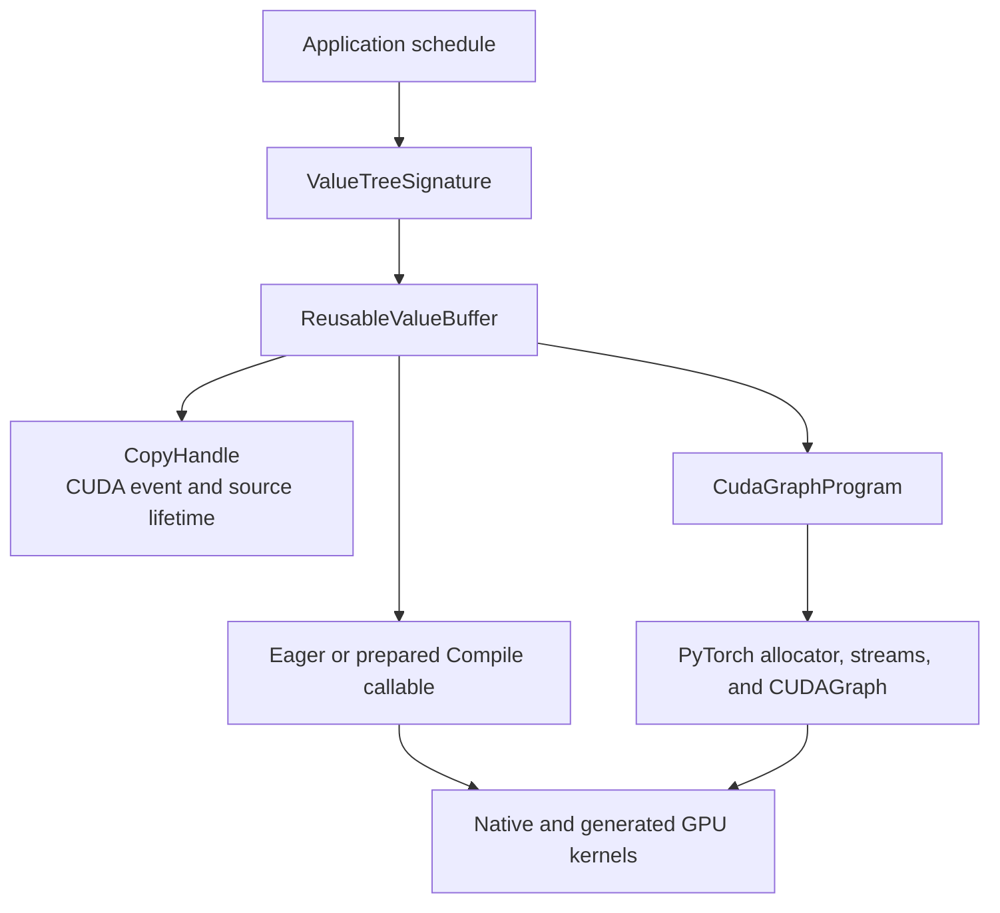
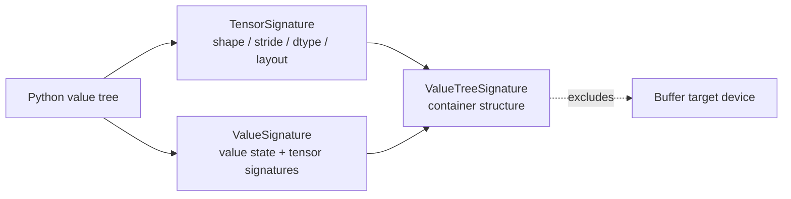
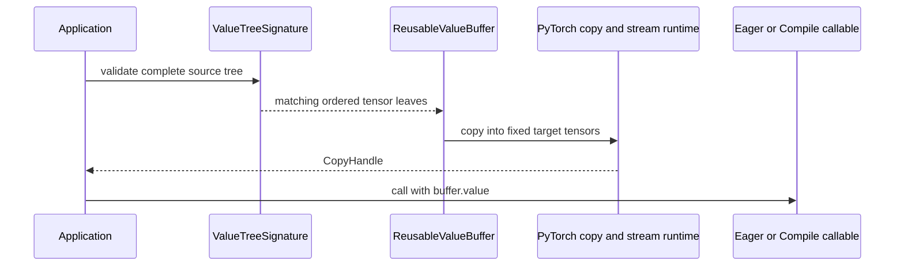
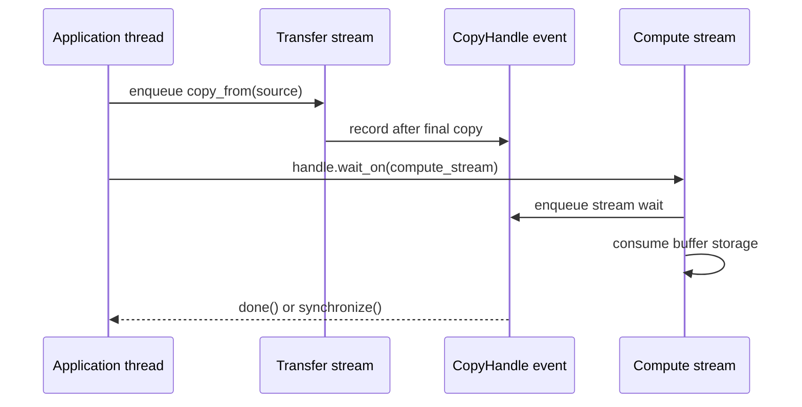
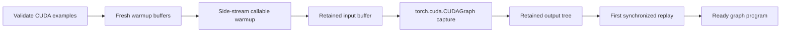
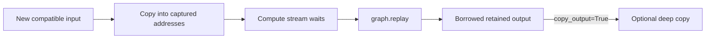

# Execution buffers and CUDA Graphs

This page describes the storage and CUDA Graph mechanisms of execution. The native Runner of a compiled specialization plans an arena, Graph segments, and an output region for its exec schedule (`backend/_planning.py`, `backend/runner.py`, `csrc/runner/`). `fhelium.runtime` provides device-independent value signatures, reusable fixed-address storage, `DoubleBuffer`, CUDA-event copy handles, and `CudaGraphProgram`, the manual CUDA Graph capture of a rank-local Python callable.

## Execution stack

The application decides what constitutes one program, which inputs are dynamic, which resources are captured as static program state, when payloads move, and whether direct invocation or graph replay is appropriate.

## Device-independent value signatures

`ValueTreeSignature` recursively describes supported lists, tuples, dictionaries, raw tensors, and FHElium values.

A `TensorSignature` records:

- shape and stride;
- dtype and tensor layout;
- `requires_grad`.

A `ValueSignature` additionally records the serialization type and schema, normalized stored arithmetic metadata, and ordered tensor-leaf signatures. That metadata includes fields such as depth, scale, representation, domain, basis, `prime_ids`, and key specialization where present. It does not record CKKS parameter provenance.

Signatures are device-independent. Compatible CPU and CUDA sources can feed the same fixed CUDA buffer, whose storage records the target device.

Validation walks the complete candidate tree before the first copy. A structure, tensor topology, or value-state mismatch therefore cannot leave a reusable buffer partially updated.

## Fixed-address value buffers

`ReusableValueBuffer.like(example, device=...)` allocates an independent tree whose tensor structure and value metadata match `example`. Its tensor addresses remain stable while `copy_from` replaces payload bytes.

The buffer reconstructs ordinary `torch.Tensor` and FHElium value objects around its owned storage. An Eager callable or prepared Compile interface consumes `buffer.value` through its ordinary arguments.

Buffer construction rejects ambiguous multi-device examples without an indexed target, unsupported leaves, and aliased representative storage. `pin_memory` requires a CPU target and creates pinned host staging suitable for non-blocking host-to-device copies.

A `ReusableValueBuffer` owns fixed storage identified by a value signature. Deployment code associates buffers with models and requests and chooses tile order, prefetch, and eviction policy. Double buffering uses two independent buffers.

## Copy handles and stream ordering

A CPU-target copy completes synchronously and returns a handle with no CUDA event. A CUDA-target copy can be enqueued on a caller-selected stream. Its `CopyHandle` retains the submitted source tensor leaves until the recorded event completes, preventing the source storage from being released or replaced while a DMA operation may still read it.

`wait_on(stream)` inserts a stream dependency without blocking the CPU. `synchronize()` blocks the caller and releases retained source references. Supplying a stream from another CUDA device is an error.

When overwriting a buffer, the application must provide ordering against prior readers. A copy-completion event proves that the new payload is ready; it does not prove that an earlier evaluator has stopped reading the old payload.

## Runner storage and Graph segments

`plan_schedule` in `backend/_planning.py` rewrites a translated schedule before the Runner is built:

- **Storage classes.** An `alloc` buffer that is neither returned, carried through structured control flow, nor returned by an operation that may alias its arguments becomes an `arena` buffer at a fixed byte offset; its `alloc` and `release` instructions are dropped. Other allocations stay per-call; those that reach the results become `output` buffers. With segments, an `output` buffer with one allocation and a static CUDA layout is placed in the Runner's output region with `place_output`.
- **Arena offsets.** Each arena buffer is live from its first to its last instruction, extended to the end of a loop in which it is used. Buffers are placed largest first at the lowest 256-byte aligned offset that does not overlap a buffer with an intersecting lifetime.
- **Segments** (`graphs=True`). Maximal runs of capture-safe nodes of the top-level block, where a loop or branch is one node, are enclosed in `begin_segment`/`end_segment`. Segments stay out of loop bodies, because a segment reading a changing induction variable would be captured again on every iteration.

Capture safety is a static property of an instruction: launches, copies, views, zeroing, calls of safe callees, and operator calls on Tensors of one CUDA device are safe unless the operator carries `torch.Tag.cudagraph_unsafe` or reads device values on the host; collectives on CUDA buffers are safe, and a segment runs directly when its process group cannot be captured; Python calls and CPU operations are unsafe. A collective that transfer planning places on a communication stream runs outside Graph segments, which end at it.

A shared Runner uses the device's `shared_arena`, which grows to the largest requirement among the Runners using it. A growth makes each of them derive its arena views and capture its segments again at its next execution. A Runner whose execution starts while another execution on the shared arena has not returned uses a private arena for that execution. `compiled_execution_bytes(device)` reports the shared arena and Graph pool, and Residency budgets subtract it.

At run time a segment executes directly on its first run. Live-in Tensors that lie in another Runner's storage are read in place; the segment keys its captured variants by their addresses, captures a variant on the second run with the same key, and keeps up to four variants, replacing the least recently replayed. Other live-in Tensors are staged into storage the Runner owns. With automatic selection, a segment records the device time of its first direct run and of the three replays after its capture, reads the events at a later run after they complete, and keeps the Graph only when the median replay is shorter; the choice persists across later captures. A variant whose recorded inputs are no longer replayable drops all variants of the Runner, which share one pool, and the segment captures again.

Before a top-level run writes the output region, `Program::detach` moves every result of the previous run that is still referenced outside the Runner to fresh storage and redirects its `StorageImpl`, so views follow; each move increments `detached_outputs`. `graph_stats` and `segment_stats` of `ProgramExecutable` expose these counters, the variants, and the segment decisions.

## Manual CUDA Graph capture

`CudaGraphProgram.capture(function, example_inputs=...)` specializes one Python callable to a fixed input structure and CUDA device. Parameters captured through a closure, `functools.partial`, or a callable object are static program state. `example_inputs` define dynamic positional values backed by one retained `ReusableValueBuffer`.

Capture proceeds as follows:

Warmup uses fresh storage so lazy backend initialization does not mutate the addresses retained for capture. The captured callable invokes its prepared native or generated kernels; CUDA Graph records those launches and their fixed storage addresses. For manually owned capture, construct a compiled callable with `graph=False`, prepare the desired specialization, and warm any lazy device-code compilation as described in [Linking, exec schedules, and the Runner](linking-and-runner.md).

Dynamic keyword arguments and arbitrary Python control objects are not captured. Adapt a dynamic keyword-only tensor into a positional input and keep dynamic control flow outside the graph.

## Replay and output ownership

The convenience replay path validates and copies new inputs, orders graph launch after the copy, and returns the retained output object. The advanced path separates `copy_inputs_from` from `replay_prepared`, allowing transfer and compute streams to be scheduled by the application.

The default output is borrowed storage. The next replay overwrites it. A caller that must retain a result uses `copy_output=True` or copies the result through another mechanism.

One `CudaGraphProgram` owns one input/output storage set and does not support concurrent replay. Independent concurrent workers require independent program instances.

## What capture fixes

CUDA Graph capture fixes:

- target CUDA device;
- nested dynamic input structure and value metadata;
- target tensor shape, stride, dtype, and addresses;
- Python-resolved operation schedule;
- keys, plaintexts, tables, and other resources captured in closure state;
- output object structure and storage addresses.

The application retains responsibility for:

- encryption or key generation before the captured schedule;
- distributed collectives around rank-local replay;
- request routing or concurrency;
- cache selection or Residency admission;
- dynamic branches whose Python outcome changes between replays.

## Source layout

| Responsibility | Source |
| --- | --- |
| Tensor, value, and nested-tree signatures | `fhelium/runtime/signature.py` |
| CPU and process-visible CUDA topology observation | `fhelium/runtime/topology.py` |
| Host/CUDA capacity and availability snapshots | `fhelium/runtime/memory.py` |
| Fixed storage, payload copying, and `CopyHandle` | `fhelium/runtime/buffer.py` |
| Manual capture, replay, output lifetime, and statistics | `fhelium/runtime/cuda_graph.py` |
| `DoubleBuffer` | `fhelium/runtime/buffer.py` |
| Schedule planning: storage classes, arena, segments | `fhelium/backend/_planning.py` |
| Schedule translation, Runner construction, shared arena | `fhelium/backend/runner.py` |
| Native Runner, segment variants, detach | `csrc/runner/runner.cpp`, `csrc/runner/graph_capture.h` |
| Public package surface | `fhelium/runtime/__init__.py` |

## Validation

Execution changes should cover:

- nested structures and unsupported leaves;
- value-state and tensor-topology mismatch before the first copy;
- CPU, pageable host, pinned host, and CUDA source paths as applicable;
- source lifetime until copy-event completion;
- cross-stream waits and wrong-device stream rejection;
- stable target pointers across payload replacement;
- eager buffer consumption;
- warmup, capture, first replay, and sequential replay;
- borrowed-output overwrite and owned-output copying;
- close behavior with pending copies or replay work.

The focused suites are `tests/runtime/test_execution_buffer.py`, `tests/runtime/test_cuda_graph_execution.py`, and, for Runner segments, `tests/compile/test_graph_executor.py`.

## Continue

- [Value signatures and buffers](../concepts/execution/signatures-and-buffers.md)
- [Compiled execution](../concepts/execution/compiled-execution.md)
- [Linking, exec schedules, and the Runner](linking-and-runner.md)
- [Distributed internals](distributed-internals.md)
- [Residency plans and execution](residency-plans-and-execution.md)
