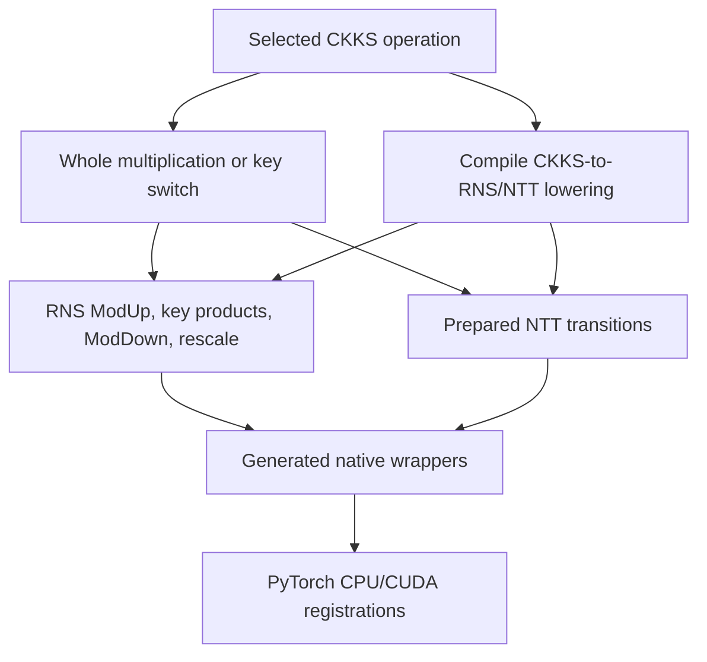
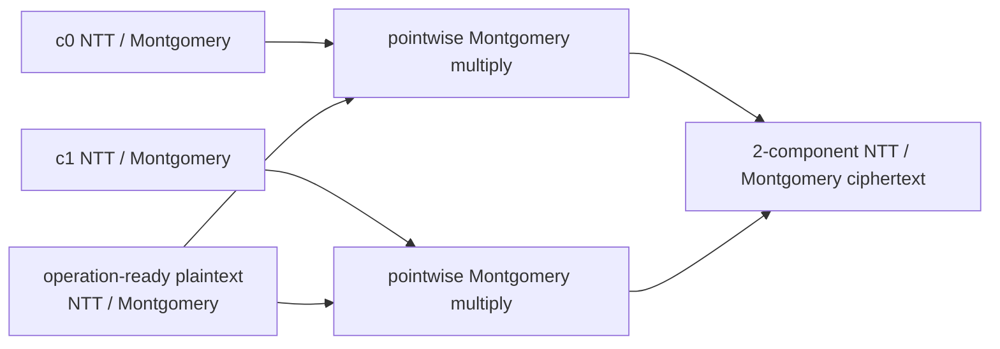
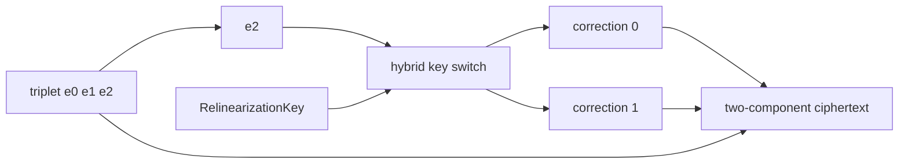
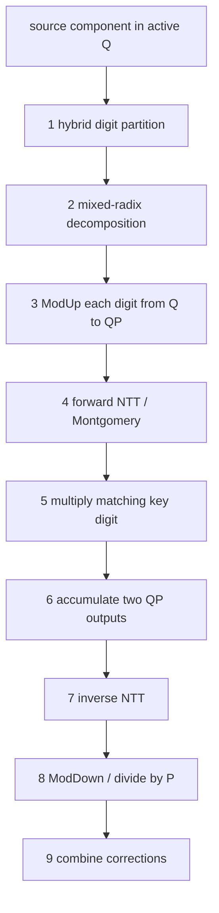
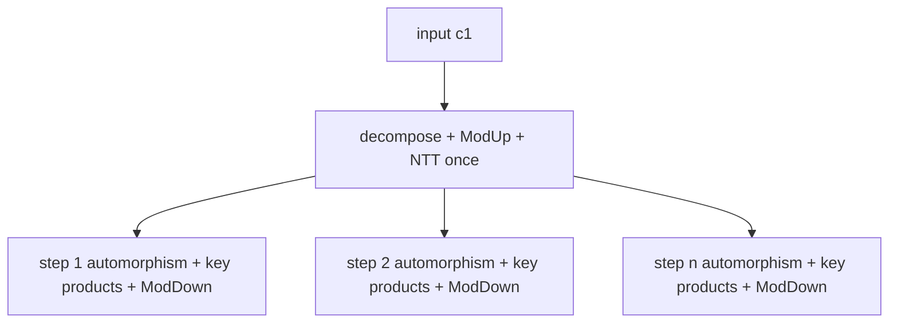
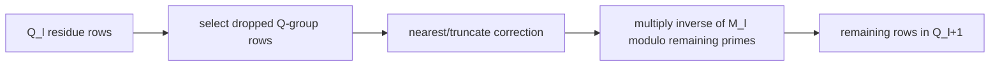

# Multiplication, key switching, and rescale

Ciphertext multiplication forms a component convolution, key switching changes the secret-key relation, and rescale computes a rounded quotient over a complete Q depth group. Their implementations share RNS basis-conversion and NTT algorithms while preserving active rows, per-value scale, and residue representation.

## Numerical implementation path



`backend/ckks/arithmetic.py` implements whole two-component convolution. `backend/ckks/key_switch.py` composes key-switch corrections, and `backend/ckks/rotation/` owns Galois selection and hoisted execution. Numerical ModUp, key products, ModDown, and prime-group rescale live under `backend/rns/`; transform execution lives under `backend/ntt/`. Eager supplies direct operation metadata, while manual and callable Compile use represented Program state. Both consume these numerical implementations.

## Plaintext multiplication

Conceptual data flow:



The output scale is multiplied, but depth is unchanged until a rescale. `multiply_plaintext` does not perform hidden forward or inverse NTTs; the caller places transitions around a multiplication region directly or through selected Compile passes. Compatible products may be added in NTT form and converted to coefficient-domain standard residues once before rescale. Prepared plaintext reuse must match depth, scale, basis, prime IDs, domain, and residue representation exactly.

## Ciphertext multiplication

For two components $(c_0,c_1)$ and $(d_0,d_1)$:

$$
(e_0,e_1,e_2)=
(c_0d_0,\;c_0d_1+c_1d_0,\;c_1d_1).
$$

Two-component multiplication requires compatible NTT/Montgomery inputs and returns a three-component NTT/Montgomery ciphertext. The result scale is the product $\Delta_c\Delta_d$; equal input scales give $\Delta^2$. The caller or selected scheduling passes place relinearization and rescale. A caller may request them separately or select a relinearization that also consumes the next complete Q group.

## Relinearization



The original first two components are combined with corrections that replace the $s^2$ dependency represented by `e2`. With `rescale=False`, depth, Q rows and actual scale are preserved. Coefficient output inverses all required terms. NTT output inverses only `e2` for digit decomposition, retains the first two components as evaluations, and adds NTT-domain corrections.

`Engine.relinearize(product, key, rescale=True, ...)` combines relinearization with removal of the next complete Q group. Let $P$ be the key's auxiliary product, $D$ the dropped Q-group product, $v_i$ the accumulated key products before adding the original component $a_i$, and $H_P,H_D$ the respective rounding offsets. Floor uses offset zero; nearest uses $(M-1)/2$ for an odd divisor $M$. Coefficient-wise integer division satisfies

$$
\left\lfloor\frac{\left\lfloor(v_i+H_P)/P\right\rfloor+a_i+H_D}{D}\right\rfloor
=
\left\lfloor\frac{v_i+P a_i+H_P+P H_D}{P D}\right\rfloor.
$$

The key is selected at the product's input depth. The result has two components, advances depth by one, removes every prime in $D$, and carries actual scale $\Delta_{product}/D$. `moddown_rounding` and `rescale_rounding` choose the two offsets independently. When both select nearest, their combined offset is $(PD-1)/2$.

RNS owns the shared quotient over $PD$ and its ordered numerical operands. The numerator adds $P a_i$ on Q rows and zero on P rows. Coefficient output evaluates this quotient in coefficient representation. NTT output retains the surviving Q evaluations, inverses only the dropped Q and P rows, and transforms the resulting quotient correction. Whole execution and logical lowering use the same numerator, offset and output-state equations. Capture records the compound operation's joint materials; separately requested relinearization and rescale retain their own operands and transitions.

## Hybrid key-switch pipeline



Each stage has distinct row, basis, and representation requirements. Fusing stages may be useful, but a fused operator must preserve the same observable state and residue-range assumptions.

## Hybrid digits across depths

`KeySwitchKey.digit_prime_ids` records the mathematical Q-prime support of each stored key plane. `prime_ids` records the stored QP rows. These facts travel with copies, device moves, subclasses and serialized keys; neither an Engine default nor a Tensor shape supplies a missing partition.

Reusing an existing key on a smaller Q basis intersects each original digit support with active Q and retains its stored Tensor plane index. Fresh generation with `source_depth=0` and the default P uses the configured depth-zero decomposition. Selecting another source depth or supplying `p_prime_ids` uses a greedy partition of the active Q basis constrained by the chosen auxiliary product. In either scope, `digit_prime_ids=` supplies a caller-selected partition. The resulting supports are recorded on the new key. Restricting an existing key and generating a compact key therefore retain their respective mathematical digit definitions.

Key generation stores `[Q_source | P_key]` in that order. Operand preparation projects parameters and NTT tables into `[Q_active | P_key]`, retaining the key's physical Q offset and original digit-plane indices. RNS quotient tables use the same ordered basis. The product $P_{key}^{-1}$ is computed only on the active Q rows, which are disjoint from P; inactive catalog Q rows may themselves belong to P. Prepared numerical operands carry these projections through whole execution and logical lowering. When supplied operands already determine the physical extent, absent depth or row identities remain unknown rather than being inferred from the configuration's default P.

`key_row_start` is a physical offset into the supplied key Tensor. Operand preparation, whole-operation execution and lowering use the actual partition and ordered row IDs. A shared `EvaluationKeySet` may contain multiple layouts for one role or step. Selection checks active Q support, P rows, physical layout, ring dimension, dtype and device. Keys selected for one hoisted or aggregated group must share the effective digit partition and physical interpretation required by that operation.

The `modup_method` argument defaults to `"exact"` and also accepts `"crt"` or `"normalized_crt"`. Exact uses the canonical Garner lift; the CRT alternatives use the linear lifts defined in [RNS and NTT architecture](rns-and-ntt.md#linear-crt-lifts). The source-Q congruence is preserved, while the larger integer representative changes evaluation-key noise. Choose the lift together with P, the digit partition, actual ciphertext scale and the required output error. The selected method remains an operation fact through capture, hoisting and lowering; implementations consume its supplied numerical tables.

## Rotation and hoisting

Rotation applies a Galois automorphism and then key-switches the transformed secret dependency. For several steps on the same input component, preparation can be shared:



Step-specific work and outputs remain. Hoist chunking must account for live prepared digits, accumulators, rotated outputs, and key residency.

The native product accumulator can gather the prepared digit's NTT indices while reading it. This combines the rotation-specific permutation with multiplication by the key, avoiding a separate permuted-digit tensor. It changes neither the key's row order nor the destination accumulator order.

### Keeping key-switch outputs in NTT representation

`Engine.rotate_with_key(..., output_domain="ntt")`, `Engine.rotate_many_with_keys(..., output_domain="ntt")`, `relinearize`, `switch_key`, `conjugate`, and the corresponding CKKS operation attributes request NTT/Montgomery outputs. The default remains coefficient/standard. Output representation alone preserves Q rows, depth and actual scale; `relinearize(..., rescale=True)` additionally applies the complete-group state transition described above.

The logical `rns.ModDownNttQpToQOp` removes P without inverting the Q rows. For QP NTT data $\widehat{x}$, let $r\in[0,P)$ be the coefficient representative reconstructed from the P residues. Then

$$
\widehat{y}_{q_i}
=\widehat{x}_{q_i}P^{-1}
+\operatorname{NTT}_{q_i}(-rP^{-1})\pmod{q_i}.
$$

This is coefficient-domain ModDown followed by forward NTT. The implementation inverts only P rows, builds the correction in Q, and adds its forward transform to the retained Q evaluations multiplied by $P^{-1}$. Shared rotations also transform the input's $c_0$ once and permute those evaluations for each output. The consumer can multiply these results by NTT plaintexts without another coefficient-to-NTT transition. Output representation is a caller-selected part of the operation, independent of CPU or CUDA execution.

An independent `rotate_with_key` may also consume NTT/Montgomery input. The automorphism permutes both components in NTT representation; only the second component is inverted for hybrid decomposition and key switching. When NTT output is requested, the permuted first component remains in NTT and receives the NTT-domain correction directly. This form is useful when both the producer and consumer already use NTT values, but it is not assumed to be the fastest form on every CPU and GPU workload.

For independent rotations with coefficient input, the $c_0$ contribution is added to the coefficient correction before its forward NTT. Linearity gives $\operatorname{NTT}(c_0+\delta)$ instead of separate transforms of $c_0$ and $\delta$. The compact radix-2 implementation folds multiplication of the retained Q evaluations by $P^{-1}$ and addition of the correction into the final NTT write.

The same NTT policy also supports streaming digit consumption: the last NTT stages directly multiply the digit by both evaluation-key components and add the products to QP accumulators. The digit scratch is disposable; its completed NTT values are not written back. Each scratch is released before the next digit is prepared. Other NTT policies retain their separate transform and product implementation, with the same CKKS operation semantics.

## Rescale

For the leading active Q depth group $G_l$, let $M_l=\prod_{q\in G_l}q$:

$$
c'\approx\operatorname{round}(c/M_l)\pmod{Q_{l+1}}.
$$



The implementation must select constants using configured prime identities, not an ambiguous compact row position. Output metadata must increase depth, remove all IDs in the dropped group, reduce row count by that group's size, and update scale by $M_l$.

NTT/Montgomery input can remain in that representation. The implementation inverts the dropped group's rows to obtain the rounding value, forms the quotient correction on surviving Q rows, transforms that correction, and adds it to the surviving evaluations multiplied by $M_l^{-1}$. This is congruent to coefficient rescale followed by a forward NTT without inverting the surviving input rows.

## Correctness hazards

High-risk errors include:

- using local row count to infer the wrong configured modulus;
- selecting the wrong key digit after earlier primes are dropped;
- mixing Q and QP parameter rows;
- applying NTT tables for another active slice/device;
- treating singleton digits as a normal full group;
- violating lazy/standard residue-range assumptions across fused operators;
- copying or overwriting staged data before another stream/device is done;
- reconstructing correct tensor values with wrong public metadata.

## Validation matrix

For a change in these paths, cover:

```text
fresh single operation
chained operation across several depths
depth 0 / middle / maximum depth
single-row digit and shortened digit
Q / QP
2 / 3 components
functional / in-place
multiple NTT backends
logN = 14 smoke and target logN = 15 or logN = 16
source build and installed wheel
world size 1 and 2+ if transport/partition is involved
```

Decrypt after every legal materialization step to localize the first incorrect stage.

## Continue

- [Encoding, randomness, and key construction](encoding-randomness-and-keys.md)
- [Tensor materials and operation preparation](materials-and-preparation.md)
- [Scale and depth lifecycle](../concepts/ckks/scale-and-depth-lifecycle.md)
- [RNS and NTT architecture](rns-and-ntt.md)
- [Native operator workflow](native-operator-workflow.md)
- [Evaluator operation transitions](../concepts/ckks/evaluator-operation-transitions.md)
- [Rotation-hoisting tutorial](../tutorial/rotation-hoisting.md)

## Source map

| Path | Source owner |
| --- | --- |
| Public multiplication, relinearization, rotation, and plaintext calls | `fhelium/eager/_engine.py` |
| Hybrid decomposition, ModUp, key products, and ModDown | `fhelium/backend/rns/`, `fhelium/backend/ckks/rotation/` |
| Whole-operation streaming implementations | `fhelium/backend/ckks/arithmetic.py`, `fhelium/backend/ckks/key_switch.py` |
| Rescale resources and quotient construction | `fhelium/backend/rns/tables.py`, `fhelium/backend/rns/rescale.py` |
| RNS/NTT arithmetic and active parameters | `fhelium/backend/rns/context.py`, `fhelium/backend/ntt/` |
| CKKS-local operator schemas | `csrc/ops/ckks/ckks.cpp` |
| CPU CKKS tensor primitives | `csrc/ops/ckks/cpu/ckks_cpu.cpp` |
| CUDA Galois, key-switch, plaintext, and rescale kernels | `csrc/ops/ckks/cuda/` |
