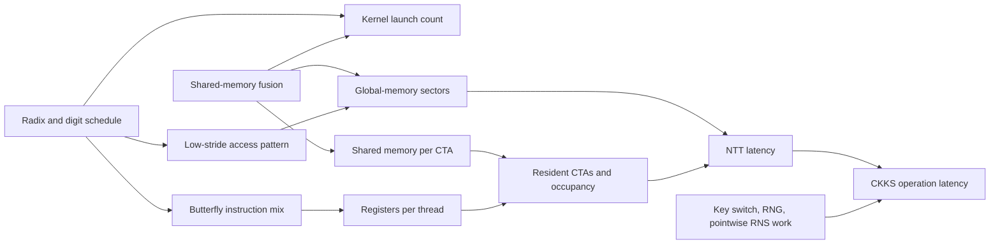

# Choose an NTT implementation

FHElium provides several mathematically equivalent Number Theoretic Transform (NTT) implementations, called **NTT backends**. A backend changes how the device executes the forward and inverse transforms; the CKKS parameters and the mathematical result stay the same. Relative latency depends on the GPU, ring dimension, number of active primes, and surrounding CKKS operation. Use the default for a first evaluator and compare alternatives once a correct, representative workload runs on the target GPU.

This guide measures the candidates with `fhelium benchmark recommend ntt`, applies the result, and then explains how to interpret close or contradictory measurements. The selected policy is applied through the Engine option or Compile implementation selection described in [Select an operation implementation](select-operation-implementation.md).

## Hold the comparison fixed

Use a CUDA-capable build, a supported preset, and an otherwise idle target device. Hold these variables constant across candidates:

- GPU model, device index, clocks and power limit, and competing GPU activity;
- FHElium version, PyTorch build, CUDA runtime, and driver;
- CKKS preset and therefore `logN`, Q/P prime counts, and residue dtype;
- semantic operation and input representation;
- warmup, timed-run, and repetition counts.

Preserve the invoking CPU thread settings unless an override is supplied, and record the effective intra-op and inter-op counts.

Strict high-radix backends support only compatible ring dimensions: for radix $R=2^b$, `logN` $L$ satisfies $L \bmod b = 0$. `fh.compatible_ntt_backends(logN)` lists the backends that accept a ring dimension, and the command below only tests compatible names.

## Measure in three steps

The command calls each fixed list of measured operations a `suite`:

- `--suite kernel` measures prepared forward NTT, inverse NTT, and an NTT round trip as complete NTT method calls, excluding Engine and input construction. This guide calls it the **NTT-only test**; it reports method calls, not individual kernel launches.
- `--suite ckks-primitive` measures complete `fhelium.eager.Engine` method calls: encryption, decryption, multiplication followed by relinearization, one rotation, and four rotations that share one ciphertext decomposition (grouped hoisting). This guide calls it the **complete-CKKS test**.

The first test removes clearly slower transform implementations; the second selects among the remaining candidates after NTT work is combined with the other work inside common CKKS operations.

### 1. Time NTT operations only

```bash
fhelium benchmark recommend ntt \
  --suite kernel \
  --preset slots32768-scale40-depth34 \
  --device cuda:0 \
  --output results/ntt-kernel.json
```

### 2. Time complete CKKS operations

```bash
fhelium benchmark recommend ntt \
  --suite ckks-primitive \
  --preset slots32768-scale40-depth34 \
  --device cuda:0 \
  --output results/ntt-ckks-primitives.json
```

This command creates keys before timing, validates decrypted results, and measures `encrypt_message`, `decrypt_message`, multiplication followed by relinearization, one keyed rotation, and four rotations through grouped hoisting. Key generation and correctness checks are outside the timed region.

### 3. Confirm the application

The complete-CKKS test gives every measured operation equal weight; a production workload does not. Confirm the remaining candidates with representative depths, batch sizes, relinearization and rotation counts, and the execution path being deployed, Eager or compiled. Keep the two reports with the application measurement so the scope of each decision remains visible.

## Read the recommendation

For backend $b$ and operation $o$, the command computes a latency ratio against the best backend for that operation,

$$
r_{b,o} = \frac{\operatorname{median}(t_{b,o})}
                 {\min_j \operatorname{median}(t_{j,o})},
$$

and ranks backends by the equal-weight geometric mean over the suite's operations,

$$
S_b = \exp\left(\frac{1}{|O|}\sum_{o\in O}\log r_{b,o}\right).
$$

The geometric mean keeps a millisecond-scale operation from outweighing a microsecond-scale operation because of units; it does not weight operations by their importance to an application. A gap of at most 3% is a near tie, and when the current default is in that set the command retains it. A high-confidence label additionally requires:

- at least three repetitions and five timed runs per operation;
- the same winner in every repetition;
- at least a 5% margin over the runner-up;
- at most 5% median within-run **coefficient of variation**, the sample standard deviation divided by the sample mean of each timed operation.

## Worked example

This example screens the compatible GPU policies for `slots32768-scale40-depth34`, whose ring dimension is $2^{16}$, on an NVIDIA RTX PRO 6000 Blackwell Max-Q Workstation Edition with a 300 W power limit (compute capability 12.0, `sm_120`). It uses 3 warmups, 10 timed runs per operation, 3 repetitions, and seed `20260823`; each repetition starts with a different backend to reduce measurement-order bias.

<NttBackendSelectionChart />

| Backend | NTT-only relative latency | Complete-CKKS relative latency | Outcome |
| --- | ---: | ---: | --- |
| `radix2_compact` | 1.115 | 1.000 | Complete-CKKS winner and current default |
| `radix2_compact_shoup32` | 1.000 | 1.004 | NTT-only winner; within 3% of the default in complete CKKS |
| `radix4_compact` | 2.035 | 1.229 | Removed by the NTT-only test |
| `radix16_compact` | 1.605 | 1.133 | Removed by the NTT-only test |

Relative latency is $S_b$ normalized to the fastest backend of each test. The NTT-only test ran at a median SM clock of 2272 MHz and the complete-CKKS test at 2220 MHz. `radix2_compact_shoup32` wins every NTT-only repetition by 11.5%, but in complete CKKS operations the two radix-2 policies differ by 0.4%, so the command retains `radix2_compact` with a low-confidence label. The median coefficient of variation is at most 2.2% in the NTT-only test and 0.4% in the complete-CKKS test.

The same commands on an NVIDIA RTX A6000 with a 300 W power limit (compute capability 8.6, median SM clock 1800 MHz in the NTT-only test and 1875 MHz in the complete-CKKS test) rank `radix2_compact` first in both tests:

| Backend | NTT-only relative latency | Complete-CKKS relative latency |
| --- | ---: | ---: |
| `radix2_compact` | 1.000 | 1.000 |
| `radix2_compact_shoup32` | 1.134 | 1.017 |
| `radix4_compact` | 2.291 | 1.374 |
| `radix16_compact` | 1.512 | 1.163 |

## Apply the measured choice

The command prints a constructor expression. Pass the backend name to the Engine:

```python
import fhelium as fh
import torch
from fhelium.eager import Engine

torch.set_default_device("cuda:0")
engine = Engine(
    fh.Preset.slots32768_scale40_depth34,
    ntt_backend="radix2_compact",
)
```

For Compile, record the choice as an operation implementation requirement and inspect the linked implementations. Repeat the measurement when the GPU model, CUDA/PyTorch stack, FHElium version, preset, or workload changes.

To compare a focused candidate set, repeat `--backend`:

```bash
fhelium benchmark recommend ntt \
  --suite ckks-primitive \
  --preset slots32768-scale40-depth34 \
  --backend radix2_compact \
  --backend radix16_compact
```

At least two compatible names are required. `radix2_indexed` is omitted by default; it stores expanded schedules, is the CPU default, and serves as the cross-device validation reference for the compact CUDA policies. Name it when a comparison needs that reference.

## Relate backend structure to GPU cost

The backends organize the same power-of-two NTT differently:

- `radix2_compact` and `radix2_compact_shoup32` execute radix-2 stages in two passes over each prime row, with Montgomery or Shoup32 twiddles;
- `radix4_compact`, `radix8_compact`, and `radix16_compact` use strict high-radix butterflies and require divisibility of `logN`;
- `radix2_indexed` stores expanded schedules.

For a strict radix $R=2^b$ transform with $N=2^L$, the number of radix digits is $D=L/b$. If a shared-memory budget of $S$ transform bits fuses $H=\min(D,\lfloor S/b\rfloor)$ complete digits, those digits become one local region, giving approximately $D-H+1$ digit-kernel launches instead of $D$. Fusion reduces global round trips and may increase per-block resources. The compiled native policy owns this tuning; the recommendation command does not change it.

In the diagram, Cooperative Thread Array (CTA) means one CUDA thread block.



*Figure 1. Backend choice changes launch, memory-traffic, and occupancy costs; CKKS operations combine NTT latency with non-NTT work.*

- **Global-memory traffic.** High radix reduces digit count, but a terminal low-stride butterfly can scatter neighboring threads across distant addresses; if sectors per requested byte increase, fewer launches may still lose to radix-2. Inspect L1/L2 sectors and DRAM bytes per transform, sectors per request, achieved bandwidth, and forward and inverse traffic separately.
- **Registers, shared memory, and CTA supply.** A larger butterfly exposes more temporaries, and higher registers per thread or a larger shared tile can reduce resident CTAs. Compare registers per thread, shared memory per block, active and eligible warps, and blocks resident per SM. Lower occupancy matters when it prevents the kernel from hiding instruction or memory latency.
- **RNS row count.** One CKKS transform applies the backend across every active Q/P row. More rows increase parallel work and enlarge the working set, so a backend's position can change when key switching adds P rows or when a later depth has fewer active Q rows. Reproduce the active rows of the dominant depth.
- **GPU architecture.** Register-file and shared-memory capacity, residency limits, cache sizes, memory bandwidth, and instruction scheduling differ between devices, so a fused shared-memory path can win on one GPU and lose to an all-global path on another.

## Explain disagreement between the two tests

| Result pattern | Likely interpretation | Next check |
| --- | --- | --- |
| Backend wins forward and inverse NTT, then wins CKKS primitives | NTT savings survive composition | Measure the application. |
| Strong NTT-only win becomes a complete-CKKS near tie | RNG, pointwise RNS work, allocation, or key switching dilutes NTT time | Compare per-operation evidence and the application's operation mix. |
| Forward wins but inverse loses | Direction-specific schedule, coalescing, or shared prefix/suffix behavior | Profile forward and inverse kernels separately. |
| The two tests choose different clear winners | Composition changes active rows, call count, or cache and resource behavior | Count NTT calls and profile the dominant operation. |
| The repetition winner changes or CV is high | Thermal state, clock drift, competing work, first-use effects, or too few runs | Stabilize the machine and repeat. |
| One backend fails correctness | Specification or implementation defect | Stop ranking and keep the failing input and environment. |

The complete-CKKS `multiply_relinearize` measurement includes multiplication and relinearization; `rotate_many_by_steps[4]` includes grouped decomposition and four rotations. The deployed evaluator can change NTT call composition, rotation schedule, diagonal policy, and live working set, so the application measurement can select a different policy.

Profile once the ranking poses a specific contrast, such as “radix16 has fewer launches but loses inverse NTT to radix2_compact.” Profile the two candidates with the same input rows and inspect launch count and duration, registers and shared memory per launch, active warps and CTAs, L1/L2 sectors and DRAM bytes, and instruction mix and issue stalls. Normalize traffic per transform and record whether each launch is a global digit or the fused shared region.

## Make the decision

1. Reject correctness failures and incompatible strict radices.
2. Reject clearly slower candidates with the NTT-only test.
3. Select among the remaining candidates with the complete-CKKS test.
4. Keep the current default for a near tie or inconsistent repetitions.
5. Measure the production evaluator with representative depths, batch sizes, and rotation and key-switch schedule.
6. Record the Engine policy or Compile implementation requirement with the command, JSON evidence, GPU and software provenance, and application measurement.

For a production choice, also follow [Benchmark methodology](/benchmarks/methodology).
