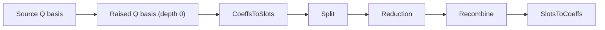

# Implement a bootstrap component

A `BootstrapPlan` consumes four replaceable component kinds: polynomial approximators and evaluation plans from `fhelium.algorithms.polynomial`, linear-transform stages and evaluation plans from `fhelium.algorithms.linear`, and a periodic reduction from `fhelium.bootstrap.periodic`. Each component defines its coordinate, polynomial basis, tensor axes, arithmetic state, depth/scale recurrence, mutation behavior, and numerical range.

## Prerequisites

Begin with a working [bootstrap plan](compose-bootstrap-circuit.md) and choose one component to replace. State its input/output coordinates, polynomial basis or tensor axes, mutation behavior, and required depth and scale transitions.

## The `Arithmetic` argument

Every component's `evaluate` method receives an `fhelium.algorithms.Arithmetic` as its first argument. It carries the per-depth target scales $s_d$ and performs the operations whose plaintext scales depend on them:

| Method | Depth | Actual output scale |
|---|---|---|
| `multiply_scalar(c, a)`, `weighted_scalar_sum([(c_j, a_j), ...])`, `advance_depth(c)` | $d\to d+1$ | $s_{d+1}$ |
| `multiply_relinearize_rescale(l, r, relinearization_key=...)` | $d\to d+1$ | $\Delta_l\Delta_r/\rho_d$ |
| `relinearize(c, key, rescale=...)` | $d$ or $d\to d+1$ | $\Delta$ or $\Delta/\rho_d$ |
| `add_scalar(c, a)`, `multiply_by_monomial(c, e)` | unchanged | unchanged |
| `align_depths(l, r)` | shallower operand advanced | target scale of the deeper depth |

Here $\rho_d$ is `config.rescale_divisor(d)`. `plaintext_scale(Δ, d)` returns the plaintext scale $\rho_d s_{d+1}/\Delta$ used by these products, `target_scales` exposes the schedule, `for_input(c, L)` follows the basis recurrence $s_{k+1}=s_k^2/\rho_k$ from an input's actual scale, and `engine` gives the remaining Eager operations such as `add`, `subtract` and `rotate`.

The same `evaluate` call serves preparation and prepared execution. `bootstrap.prepare` and `linear.prepare` run it once while the arithmetic and the supplied callbacks select keys and encode constants and diagonals, recording each in the prepared object; later calls run it again and read the recorded entries. A component therefore obtains keys only from its `relinearization_key`, `rotation_paths` or `rotate` arguments and plaintexts only through `Arithmetic` methods or `encode_diagonal`, and its operation sequence depends only on the input's depth, scale and shape.

## Polynomial approximation

An approximator chooses coefficients but not the homomorphic multiplication DAG. Use ascending-degree coefficients and record the physical design interval:

```python
from fhelium.algorithms.polynomial import Polynomial

class MyApproximator:
    def approximate(self, function, *, domain=(-1.0, 1.0), name="polynomial"):
        coefficients = fit_with_my_method(function, domain)
        return Polynomial(
            basis="power",
            coefficients=tuple(coefficients),
            domain=domain,
            name=name,
        )
```

The two built-in basis conventions are

$$
p(x)=\sum_{n=0}^{d}a_nx^n
$$

and

$$
p(x)=\sum_{n=0}^{d}a_nT_n(x).
$$

If `domain=(a, b)` is physical coordinate $t$, the coefficient coordinate is

$$
x=\frac{2t-(a+b)}{b-a}\in[-1,1].
$$

`Polynomial.evaluate_plaintext()` receives the normalized coordinate $x$. The caller performs the transformation from $t$. Its input may have any NumPy-broadcastable axes; its output preserves those axes.

`CosineDoubleAngle` calls `approximate(function, domain=..., name=...)`; an approximator that also defines `cosine(amplitude, frequency, phase)` instead returns the seed analytically, as `CosineExpansion` does through Jacobi–Anger coefficients.

## Polynomial evaluation

A polynomial plan implements `required_depths()` and `evaluate()` to execute another multiplication DAG, and optionally `operation_inventory()` and `relinearization_depths(polynomial, *, input_depth)`. `fhelium.algorithms.polynomial.evaluate` and `CosineDoubleAngle` call `evaluate`; the result of an input at depth $d$ must be at depth $d+$ `required_depths(polynomial)`:

```python
class MyPlan:
    def required_depths(self, polynomial):
        return my_depth(polynomial.coefficients)

    def operation_inventory(self, polynomial):
        return my_operation_counts(polynomial.coefficients)

    def evaluate(
        self,
        arithmetic,
        ciphertext,
        polynomial,
        *,
        relinearization_key=None,
    ):
        return my_homomorphic_dag(
            arithmetic,
            ciphertext,
            polynomial.coefficients,
            relinearization_key=relinearization_key,
        )
```

State the basis your plan accepts. The built-in plans accept two-component Q ciphertexts in coefficient/standard or NTT/Montgomery form, with axes `[component, *batch, limb, coefficient_or_ntt_index]` and active `prime_ids`. A ciphertext product produces three NTT/Montgomery components. Relinearization restores two components, and rescale moves to the next depth basis while retaining the actual quotient scale.

Several equal-state, equal-actual-scale products may be accumulated as three-component ciphertexts before a shared relinearization and rescale. `BlockedChebyshevPlan` follows this schedule for its final block products. Use one plan for dependencies, required depths, coefficient decomposition and operation inventory so those reports describe the executed circuit.

A custom plan must report its actual scale recurrence, such as $\Delta_{\rm product}/\rho_d$ for the rescale ratio $\rho_d$. It must not claim `required_depths(polynomial) == d` unless every execution path advances by exactly $d$ depths. A plan may accept `relinearization_key=None` only on an execution path whose polynomial DAG contains no ciphertext product, such as a constant or linear built-in polynomial.

## Linear-transform stages

`fhelium.algorithms.linear.radix2_dft` returns `LinearTransform` stages, which store cyclic diagonals. A custom factorization can return other immutable stages; a stage stores whatever numerical data the matching evaluation plan understands, and replaces the plan's `coeffs_to_slots` or `slots_to_coeffs` field:

```python
from dataclasses import dataclass

@dataclass(frozen=True)
class SparseStage:
    slots: int
    matrix: object

    def reference(self, values):
        return self.matrix @ values

def sparse_stages(slots, direction, generator, scale=1.0):
    matrix = synthesize_sparse_map(slots, direction, generator, scale)
    return (SparseStage(slots, matrix),)
```

`reference()` is a plaintext oracle. Document its accepted axes and whether its input is a raw physical coordinate or a normalized coordinate. The built-in radix-2 reference uses shape `[slot]` and the convention

$$
T(C(a))=Sa.
$$

The `scale` argument multiplies numerical matrix values.

## Linear-transform evaluation

```python
class SparsePlan:
    def required_rotation_offsets(self, transform):
        return tuple(rotations_used_by(transform.matrix))

    def required_depths(self, transform):
        return 1

    def evaluate(
        self,
        arithmetic,
        ciphertext,
        transform,
        *,
        rotation_paths,
        rotate,
        encode_diagonal,
    ):
        return evaluate_sparse_map(
            arithmetic,
            ciphertext,
            transform.matrix,
            rotation_paths=rotation_paths,
            rotate=rotate,
            encode=encode_diagonal,
        )
```

`rotation_paths` maps each normalized logical rotation to the ordered tuple of selected primitive keys. The `rotate` callback executes that path, while `encode_diagonal` applies the diagonal encoding/cache policy. A built-in diagonal stage encodes an unbatched `[limb, ntt_index]` Montgomery plaintext at the selected scale $\Delta_{p,j}$. For input scale $\Delta_j$ and rescale ratio $\rho_j$ of depth $j$, one stage returns

$$
\ell_{j+1}=\ell_j+1,\qquad
\Delta_{j+1}=\frac{\Delta_j\Delta_{p,j}}{\rho_j}.
$$

The output remains two-component coefficient-domain standard RNS over Q, with unchanged batch axes and the `prime_ids` of the next depth basis. If a custom plan uses another recurrence or state transition, report the differing recurrence or transition.

For a cyclic-diagonal map

$$
L(x)=\sum_kd_k\mathbin{\odot}\operatorname{Rot}_k(x),
$$

direct and BSGS evaluation are two schedules for the same linear map. A BSGS implementation should test the identity

$$
\operatorname{Rot}_g\left(
 \operatorname{Rot}_b(x)\mathbin{\odot}\operatorname{Rot}_{-g}(d_{g+b})
\right)
=
\operatorname{Rot}_{g+b}(x)\mathbin{\odot}d_{g+b}.
$$

## Periodic reduction (`eval_mod`)

A reduction component must distinguish raw and normalized coordinates. Let `input_bound` be $B$, raw input be $r$ with $|r|\le B$, and normalized input be $x=r/B$. The built-in output target is

$$
\rho_B(x)=\frac{\sin(\pi Bx)}{\pi}.
$$

A custom component protocol can be as small as:

```python
class MyReduction:
    input_bound = 1024
    fuse_input_normalization = True
    requires_relinearization = False

    @property
    def required_depths(self):
        return 6

    @property
    def fused_input_divisor(self):
        return float(self.input_bound) if self.fuse_input_normalization else 1.0

    def relinearization_depths(self, *, input_depth=0):
        return ()

    def reference(self, normalized_values):
        return my_plaintext_periodic_oracle(normalized_values)

    def evaluate(
        self,
        arithmetic,
        ciphertext,
        *,
        relinearization_key=None,
    ):
        del relinearization_key
        # With fusion, ciphertext already represents x = r / input_bound.
        return my_periodic_reduction_without_ciphertext_products(
            arithmetic, ciphertext
        )
```

The component interface specification must state:

- whether `reference()` accepts $r$ or $x$;
- whether `evaluate()` accepts $r$ or $x$ under each fusion setting;
- the raw admissible interval and output target;
- the polynomial basis and design interval;
- `required_depths` and output actual scale;
- whether `requires_relinearization` is true because evaluation performs a ciphertext-ciphertext product;
- whether ciphertext products consume the supplied relinearization keys;
- output depth, component count, domain, basis, residue representation, and `prime_ids`;
- whether execution mutates or aliases an input.

`bootstrap.plan` folds `fused_input_divisor` into CoeffsToSlots and expects it to be that numerical factor. Returning $B$ asserts that the reducer will receive $x$ and must not divide by $B$ again. The reducer is a slotwise stage and does not receive rotation keys. Its `evaluate()` method receives the keyword-only `relinearization_key`. Pass it to `arithmetic.relinearize` or `arithmetic.multiply_relinearize_rescale`: these consumers accept a primitive key, an inventory during material discovery, or a bound depth-to-key mapping during prepared execution. A custom reduction without ciphertext products can ignore that argument. `relinearization_depths(input_depth=...)` declares the depths of actual key-consuming products, including normalization offsets and delayed relinearization; an empty tuple declares no consumers, while an absent method or `None` leaves the schedule unknown and provisioning uses full-basis coverage.

## Full-slot integration requirements

A component inserted into a `BootstrapPlan` participates in this state sequence:



With $m_C$ CoeffsToSlots stages, $m_\rho$ reduction depths and $m_T$ SlotsToCoeffs stages, the output depth is

$$
\ell_{\rm out}=\ell_{\rm raise}+m_C+m_\rho+m_T,
$$

with one additional depth when the slot-count normalization is not folded into CoeffsToSlots. `plan.stages()` reports the placement.

Its final scale follows the actual SlotsToCoeffs recurrence and the entry compensation, and may differ from the output depth's default scale `config.scale_at(depth)`. A component must not hide a depth, scale reinterpretation, basis extension, NTT transition, or range normalization from its declared state-transition specification.

## Test the behavior that matters

Test components independently before inserting them into a full bootstrap:

- compare `reference()` with the intended map on the documented coordinate;
- test raw-to-normalized equivalence using $x=r/B$;
- compare encrypted component output with the plaintext oracle;
- assert output depth advancement and actual scale recurrence;
- assert component, batch, limb, and coefficient/NTT axes;
- assert domain, basis, residue representation, and `prime_ids`;
- compare direct and BSGS decoded outputs for the same mathematical map;
- run full-slot end-to-end refresh across several seeds and admissible ranges;
- measure the application's actual raw branch range and error distribution.

Investigate a numerical failure using the implemented equations, coordinate convention, scale schedule, and observed error distribution.

## Verify the outcome

Substitute the component into the same topology, validate its clear mathematical result first, and then measure encrypted error across its stated range. Preserve the component’s state and coordinate contract when comparing it with another implementation.
