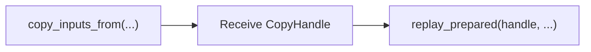

# Use CUDA Graphs

A CUDA Graph records a fixed sequence of CUDA work for replay with changing input data. A compiled callable uses CUDA Graphs by default: it divides each linked schedule into capture-safe segments and replays them. `fhelium.runtime.CudaGraphProgram` captures an arbitrary callable, such as Eager code, under application control. Keep key generation, encryption, I/O, and control decisions outside both.

## Prerequisites

Have a CUDA build, CUDA inputs, and a computation that produces the correct decoded result in Eager mode or as a compiled callable.

## Graphs of a compiled callable

```python
from fhelium import compile as fc

@fc.compile
def evaluator(x):
    return engine.rescale_to_next_depth(engine.multiply_plaintext(x, plain))

for _ in range(5):
    y = evaluator(x)
for record in evaluator.stats()["graphs"]:
    print(record["state"], record["fallback_reason"], record["replays"])
    print([segment["choice"] for segment in record["segments"]])
```

A specialization runs its schedule directly on the first call, captures every segment on the second, and replays afterwards. A segment ends at an instruction that cannot be captured, such as a Python call or a CPU operation. `graph` selects the policy:

| `graph` | Behavior |
| --- | --- |
| `"auto"` (default) | Each segment compares the device time of its first execution with the median of three replays after capture and keeps its Graph only when replay is faster; `choice` reads `"measuring"` until the decision. |
| `True` | Every segment keeps its Graph. |
| `False` | Every call runs directly. |

Host-resident Tensor inputs, inputs that require gradients, and a failure before the first capture fall back to direct execution, with the reason in `fallback_reason` (`Graph execution requires Tensor inputs on one CUDA device` for host inputs); move inputs to the device before the call to keep Graphs. Collectives on the compute stream are captured inside segments. Graphs are kept per grad, inference, and autocast context.

A Graph result occupies the specialization's output storage. A result the caller still references when the next call would overwrite that storage moves to fresh memory first; the move is counted as `detached_outputs` in the record's `capture_stats`. Compiled callables on one device share one arena and one Graph pool, and a callable that receives another callable's result reads it in place, keeping up to four captured variants per segment for the different input addresses. `evaluator.clear()` releases the Graphs and their pools. [Example 17](../tutorial/compiled-cuda-graphs.md) prints these statistics for a two-function pipeline.

To capture a compiled callable inside a manually owned Graph, construct it with `graph=False`, call `prepare` and one ordinary execution, and pass it as the schedule of `CudaGraphProgram.capture`.

## Capture Eager code manually

The remaining steps use `CudaGraphProgram`, which captures a callable once and exposes capture warmup, replay streams, split input staging, output ownership, and pool sharing.

## 1. Establish a synchronized execution baseline

Write an ordinary callable and verify it across multiple inputs. This small schedule computes $-x$ using the configured Engine; `prototype_ciphertext` must already be on CUDA:

```python
def evaluator(source):
    return engine.negate(source)

schedule = evaluator
```

Before capture, record output error against a clear-message oracle, output depth and actual scale, polynomial domain, modulus basis, component count, synchronized latency, and peak allocated/reserved memory.

## 2. Separate static and dynamic state

Bind fixed operation-ready weights, keys, and other schedule parameters in a closure or with `functools.partial`. Dynamic positional inputs contain tensors or serializable FHElium values supported by `ValueTreeSignature`. The fixed schedule may also call a previously linked executable:

```python
# Use this alternative after linking a one-input calculation.
schedule = executable.run
```

Keep static numerical materials and Backend resources alive for all captures and replays that use them. Changing a fixed key, weight assignment, or operation schedule requires a new capture.

## 3. Exclude unsafe or dynamic work

Keep outside capture:

- key generation/loading;
- fresh-randomness encryption;
- request I/O and artifact misses;
- dynamic shape/depth/control flow;
- process-group initialization;
- dynamic distributed gather/reduction;
- cache admission and eviction.

Encrypt dynamic request data before replay and decrypt results afterward.

## 4. Capture from representative inputs

```python
from fhelium.runtime import CudaGraphProgram

program = CudaGraphProgram.capture(
    schedule,
    example_inputs=(prototype_ciphertext,),
    warmup=3,
)
```

The prototype must match every later input in structure and CKKS state. The signature is device-independent; the buffer records the staging destination.

## 5. Replay changing inputs

```python
result = program.replay(next_ciphertext, synchronize=True)
```

Use synchronization while validating correctness. For production scheduling, use the API's stream/event options rather than inserting unnecessary host barriers.

If input copy should overlap with other work, use the advanced split path:



Follow the current [Execution API reference](../api/fhelium/runtime/cuda_graph.md) for arguments.

## 6. Handle borrowed output correctly

By default, replay returns storage retained by the program and overwritten by a later replay. If a result must survive:

```python
owned_result = program.replay(next_ciphertext, copy_output=True)
```

Do not infer ownership from Python object identity alone. Test by retaining two results across replays and verifying that the owned path preserves both.

## 7. Use one instance sequentially

Do not concurrently replay one program instance. For concurrent workers, create separate instances and account for each instance's:

- stable input buffers;
- retained outputs;
- graph-private allocations;
- static closure/key/weight references;
- stream and event scheduling.

## Share temporary storage across specializations

Use `CudaGraphPool` when several fixed schedules execute sequentially. Inputs and retained outputs are allocated outside its shared scratch storage. At least one warmup evaluation supplies the output prototype. Each output leaf owns cloned storage; input/output and output/output aliases are not preserved. Pooled outputs carry no autograd history. The captured callable retains the caller's grad mode, and input signatures retain their `requires_grad` state.

```python
from fhelium.runtime import CudaGraphPool, CudaGraphProgram

with CudaGraphPool(device=prototype_ciphertext.device) as pool:
    negate = CudaGraphProgram.capture(
        engine.negate,
        example_inputs=(prototype_ciphertext,),
        warmup=1,
        pool=pool,
    )
    double = CudaGraphProgram.capture(
        lambda source: engine.add(source, source),
        example_inputs=(prototype_ciphertext,),
        warmup=1,
        pool=pool,
    )
    doubled = double.replay(next_ciphertext)
    negated = negate.replay(next_ciphertext)
    # doubled remains valid until double is replayed again or closed.
    owned = double.replay(next_ciphertext, copy_output=True)
```

Prepare persistent numerical resources before capture. A captured callable must not retain newly allocated intermediates in application state outside its returned output tree. Programs may replay in a different order from capture. The pool inserts event dependencies between replay streams; input copies can still use the existing transfer-stream interface. One host caller controls a pool. Use separate pools for concurrent workers. Closing the pool waits for its submitted work and closes its programs; finish external consumers of borrowed outputs before closing it. Calling the raw underlying CUDA graph bypasses this serialization.

For one schedule with different weights, pass those weights as dynamic Tensor arguments instead of creating a program per weight set. A shared pool is useful when the operation schedule or value signature requires distinct programs.

## 8. Benchmark the full replay path

Compare:

```text
uncaptured evaluator with the same numerical schedule
CUDA Graph replay including dynamic input staging
optional owned-output copy
```

Record one-time warmup/capture cost separately. A graph result that excludes input staging while the uncaptured path includes it is not a fair end-to-end comparison.

## 9. Close after submitted work completes

Call `program.close()` only after copies, replays, and consumers have completed. Release retained borrowed outputs and references according to the application's lifetime plan.

## Verify the outcome

Replay several distinct ciphertext inputs and compare decoded results with the same clear-message oracle. Retain an owned output across the next replay to verify its lifetime, and report input staging and optional output copies in the measured scope.

## Related documentation

- [Compiled execution](../concepts/execution/compiled-execution.md)
- [Compiled CUDA Graphs tutorial](../tutorial/compiled-cuda-graphs.md)
- [Value signatures and buffers](../concepts/execution/signatures-and-buffers.md)
- [Benchmark methodology](/benchmarks/methodology)
